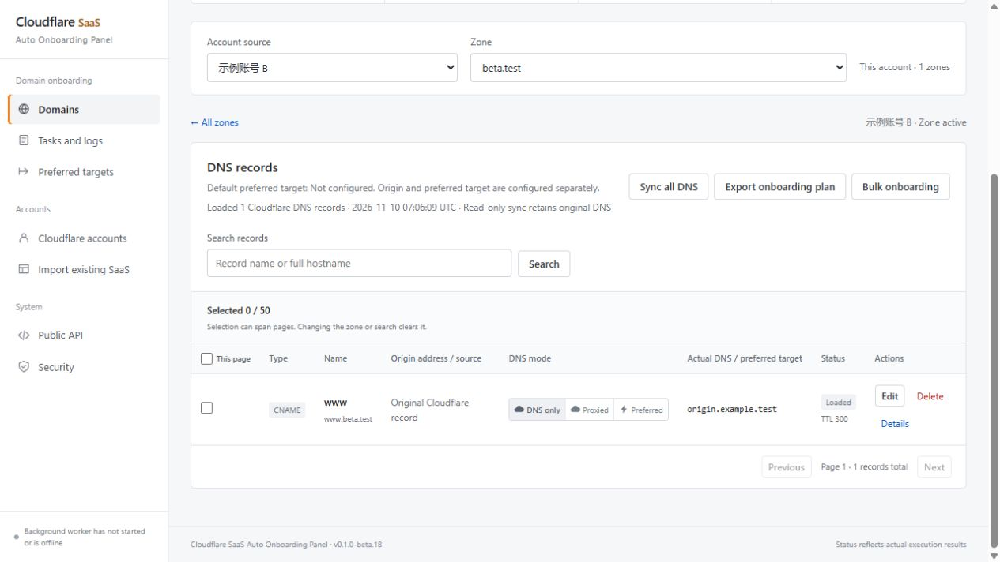

# Cloudflare SaaS Auto Onboarding Panel

[简体中文](README.md) · [Releases](https://github.com/Sigusama/cloudflare-saas-panel/releases) · [Actions](https://github.com/Sigusama/cloudflare-saas-panel/actions/workflows/ci.yml)

A PHP and MySQL panel for Cloudflare for SaaS, DNS records, TXT validation, preferred entry hostnames, and origins. Current version: **0.1.0-beta.18** (prerelease).

- Choose a source account, then a zone. Load all existing Cloudflare DNS records without changing them.
- Edit or delete existing records. A, AAAA, and CNAME records support DNS-only, proxied, and preferred modes, including bulk operations.
- Preview changes before submitting them to the background worker.
- Route business domains through a custom entry hostname to a preferred CNAME or an IP group of up to 10 addresses.
- Use an origin IP by default, or select a CNAME origin. Reuse origin presets and switch existing managed records.
- Discover existing SaaS hostnames, DNS chains, and origins. Confirm uncertain associations before adoption; adoption retains existing DNS.
- Automate TXT verification and remove only panel-owned temporary validation records when checks pass.
- Scoped public API, idempotent requests, audit logs, and configuration import/export excluding credentials.
- Simplified Chinese and English interfaces, including installation, sign-in, dialogs, and system errors. Language preference is saved in the browser. User data stays unchanged.



## Install with Docker

Requires Linux amd64 Docker Engine and Compose 2.20+. The public GHCR image can be pulled without signing in.

```sh
mkdir cloudflare-saas-panel && cd cloudflare-saas-panel
curl -fsSLO https://raw.githubusercontent.com/Sigusama/cloudflare-saas-panel/v0.1.0-beta.18/compose.yaml
curl -fsSL https://raw.githubusercontent.com/Sigusama/cloudflare-saas-panel/v0.1.0-beta.18/.env.example -o .env
```

Set two different strong database passwords in `.env`, then run:

```sh
docker compose pull
docker compose up -d --wait
docker compose logs web
```

Open `http://localhost:8080/install` and use the one-time token from the Web logs. The database host is `db`; the database name, user, and password match `.env`. Web, MySQL, and the worker have health checks. Before installation, the worker waits for setup.

The image is `ghcr.io/sigusama/cloudflare-saas-panel:0.1.0-beta.18`. Web and worker use the same version. Back up both MySQL and private storage before upgrades; keep the application key and installation lock. Update `PANEL_IMAGE`, pull, and recreate containers. Ordinary `docker compose down` retains named volumes.

To build modified source, clone this repository, set `PANEL_IMAGE=cf-saas-panel:local`, and run `docker compose -f compose.yaml -f compose.build.yaml up -d --build --wait`. PHP deployments require PHP 8.3+, MySQL 8.0+, and a separately supervised CLI worker. No Node.js runtime is required by the application.

## Cloudflare credentials

Create a custom API Token with **Zone → Zone → Read**, **Zone → DNS → Edit**, and, for the SaaS account, **Zone → SSL and Certificates → Edit**. Restrict resources to the required zones. Global API Key with account email is also supported. Enter credentials in your own installed panel; encrypted credentials, databases, and private storage are excluded from the public source and image.

Cloudflare is the only implemented DNS provider. DNSPod, speed testing, and automatic failover are future work. Existing Cloudflare plans, permissions, and origin TLS settings determine which operations are available.

## Documentation and verification

Detailed [installation](docs/DEPLOYMENT.md), [API](docs/API.md), [design](docs/TECHNICAL_DESIGN.md), and [verification status](docs/IMPLEMENTATION_STATUS.md) are currently maintained in Chinese. [Contributing](CONTRIBUTING.md) describes isolated test environments and source packaging.

`sh tests/docker-smoke.sh` builds and tests an isolated installation. Set `PANEL_SMOKE_IMAGE=ghcr.io/sigusama/cloudflare-saas-panel:0.1.0-beta.18` to test the published image instead. Tests cover installation, API boundaries, worker health, restart and container replacement persistence, and simulated Cloudflare workflows. They do not establish compatibility with every real Cloudflare account or origin.

## License

[AGPL-3.0-only](LICENSE). Preserve [NOTICE](NOTICE) and applicable copyright notices. Provide the complete corresponding source for the running version as required by the license, including when offering a modified version over a network.
