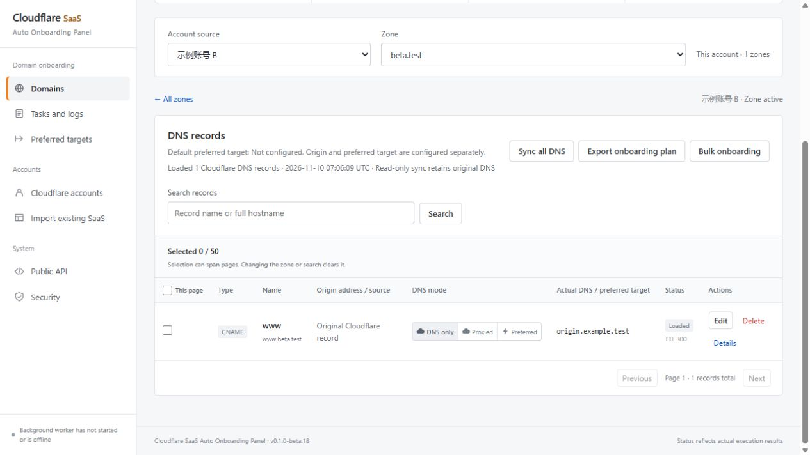
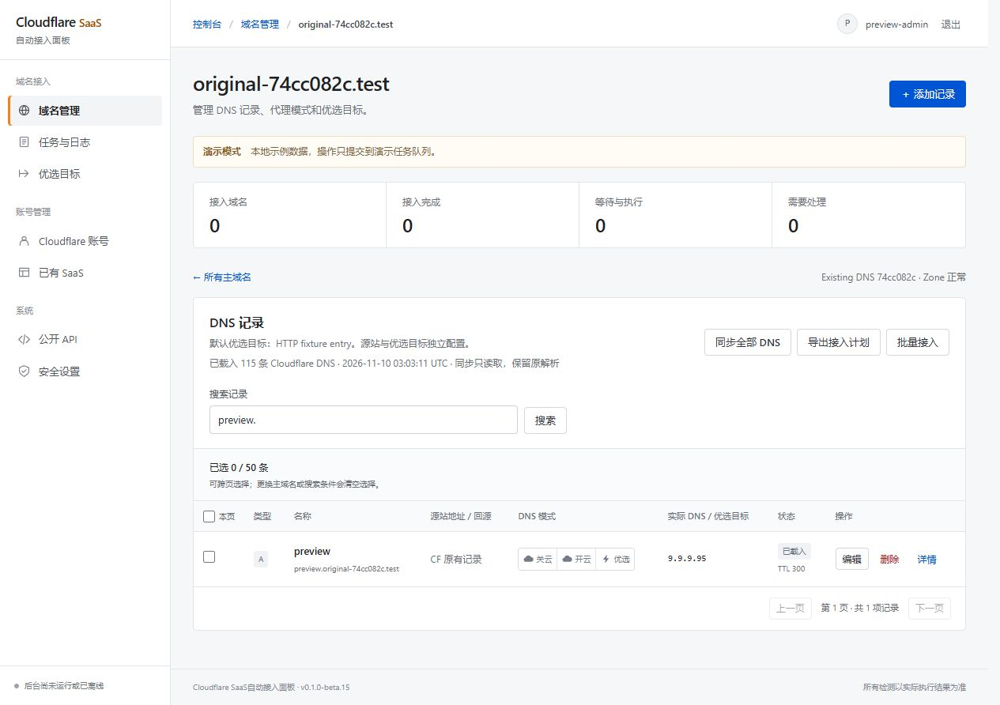
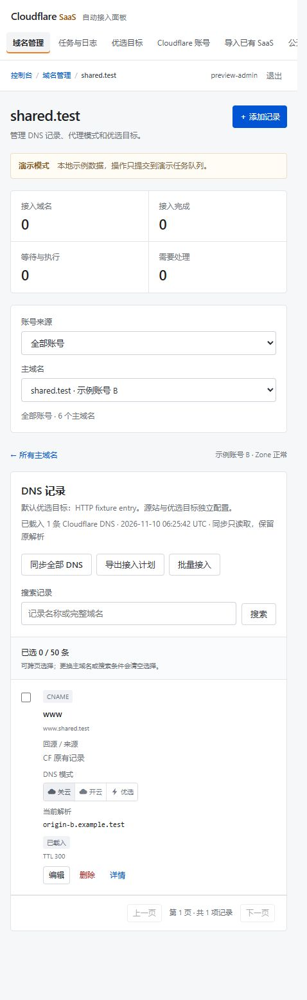
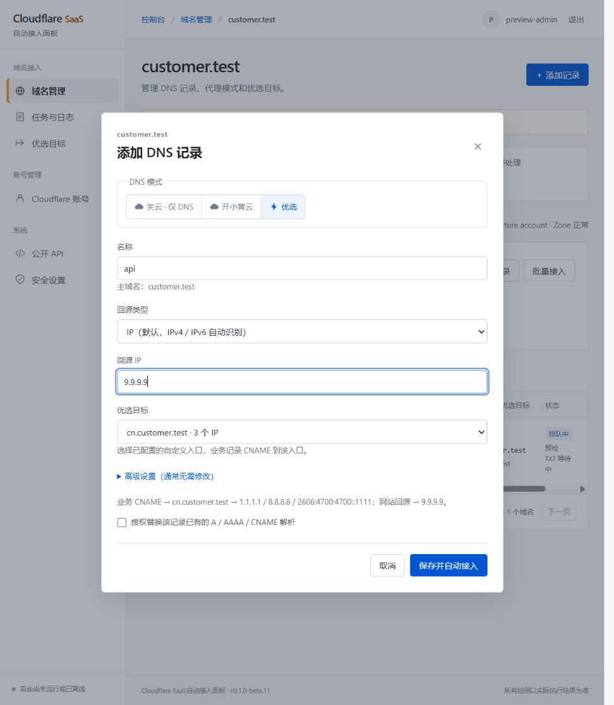
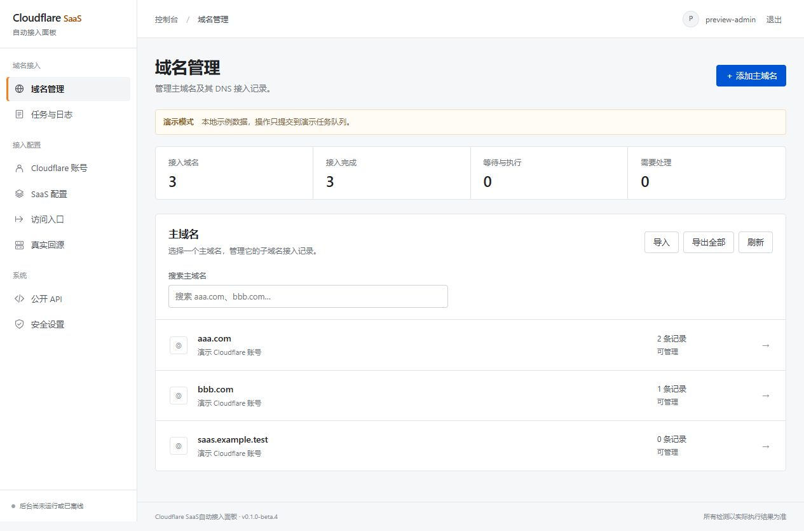
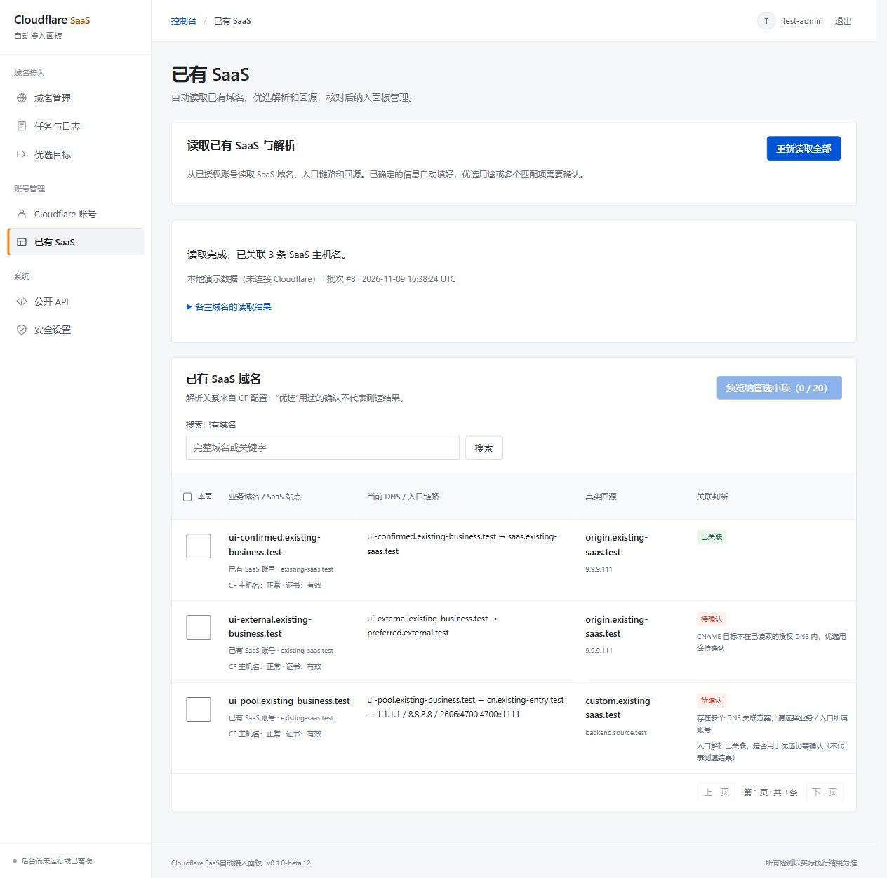

<div align="center">

<h1>Cloudflare SaaS 自动接入面板</h1>

<p>自定义主机名 · DNS 解析 · TXT 验证 · 优选入口 · 回源管理</p>

[](https://github.com/Sigusama/cloudflare-saas-panel/actions/workflows/ci.yml)
[](docs/DEPLOYMENT.md)
[](docs/DEPLOYMENT.md)
[](LICENSE)

**简体中文** · [English](README.en.md)

[界面预览](#preview) · [功能概览](#features) · [快速部署](#quick-start) · [使用流程](#usage) · [项目文档](#docs) · [许可证](#license)

</div>

基于 PHP + MySQL 的 Cloudflare for SaaS 域名自动接入面板。将自定义主机名、DNS 解析、TXT 验证、访问入口与回源配置集中管理，减少重复操作。

> [!IMPORTANT]
> **当前版本：0.1.0-beta.20（测试版）。** 安装示例直接拉取同版本公开 GHCR 镜像，修改后的源码可[自行构建](#source-build)。公开发行以 [GitHub Releases](https://github.com/Sigusama/cloudflare-saas-panel/releases) 为准，尚未发布稳定版本。Cloudflare 真实接入需要使用自己的账号和测试域名联调。版本以 `VERSION` 文件为准，可执行 `php bin/console.php version` 查询。

<a id="preview"></a>

## 界面预览

按主域名集中管理 DNS 记录，编辑、删除与模式切换均先预览再提交。



<details>
<summary>查看更多界面：创建记录、域名总览与已有 SaaS</summary>

#### 原有 DNS 编辑与模式切换



#### 账号来源与主域名选择



#### 创建 DNS 记录



#### 主域名与记录总览



#### 读取已有 SaaS



</details>

<a id="features"></a>

## 功能概览

OpenAPI 3.1.1 覆盖全部 21 个公开操作，安装后访问 `/openapi.json`，也可下载[规范文件](public/openapi.json)导入 Swagger / Postman。导入后将服务器地址改为自己的面板地址，在 Authorize 填写面板 API Key。


| 能力 | 说明 |
| --- | --- |
| **DNS 集中管理** | 按主域名加载全部 DNS 类型，支持原有记录编辑、删除和批量操作。 |
| **三种接入模式** | 关云 · 仅 DNS、开小黄云、优选；切换前预览差异，确认后提交任务。 |
| **SaaS 自动接入** | 创建自定义主机名、配置解析与回源、处理 TXT 验证，并清理本轮临时验证记录。 |
| **优选入口与独立回源** | 支持优选 CNAME 或 1 至 10 个 IPv4 / IPv6，每条业务记录可配置回源 IP 或 CNAME。 |
| **已有资源纳管** | 读取已有 SaaS、证书状态与入口链路，预览确认后按现状纳管。 |
| **批量与配置迁移** | 每批最多 50 条记录；支持全部配置或单个主域名的 JSON 导入导出。 |
| **任务与变更追踪** | 后台执行、失败重试、状态诊断、变更快照、回滚与审计日志。 |
| **部署与程序接入** | Docker Compose、Web 安装向导、管理员登录及 API Key 鉴权的公开 API。 |
| **中英文界面** | 安装、登录和控制台支持语言切换；翻译系统标签与错误，保留用户数据原值。 |

<details>
<summary>查看完整功能清单</summary>

- 按主域名载入 Cloudflare 全部 DNS 类型（含 A / AAAA / CNAME / TXT / MX / CAA / SRV 等），原有记录可编辑、删除及批量操作。A / AAAA / CNAME 可切换关云、开小黄云和优选；先预览差异，再确认提交，未提交前保留原解析。
- 域名管理与 DNS 记录页共用账号来源和主域名选择，可查看全部账号或指定账号；全部账号下按账号分组显示各自主域名，切换后清空旧记录的批量选择。
- Cloudflare 账号与首次 SaaS 服务设置，SaaS 与 DNS 可使用不同账号。
- 自动读取已有 SaaS 域名、证书 / 验证状态、回源与 DNS 入口链路；明确项自动填好，推断项待确认，选择预览后纳入管理。
- 「导入已有 SaaS」用于首次接管历史配置；日常直接在域名管理操作。业务主域名不必配置 SaaS 默认回源，缺少时显示未配置，普通 DNS 管理继续可用。
- 读取与关联自动完成，纳管由管理员选择并确认；不自动接管未确认的域名，不改写其原解析。
- 按主域名创建 DNS 记录，默认填写回源 IP，也可手动填写 CNAME 源站。
- 优选目标选择入口主域名、自定义前缀，再填写优选 CNAME 或 1 至 10 个 IP；业务域名统一 CNAME 到此入口。
- 每条记录可切换「关云 · 仅 DNS」「开小黄云」「优选」；前两种直接使用源站 IP / CNAME，优选使用 SaaS 和所选入口。
- 当前主域名下多选记录、全选本页、跨页选择；每批最多 50 条，先预览，再批量切换模式或删除。
- 批量处理逐条校验版本、任务和归属，部分失败不影响其余记录，支持幂等提交及批次审计。
- 全部配置或单个主域名的 JSON 导出，账号绑定、导入预览及事务提交。
- 单个或批量接入域名，自动配置 CNAME / A / AAAA 和 TXT 验证。
- 公共优选域名或自定义 IPv4 / IPv6 入口。
- 多个自定义回源预设，例如 `dns.xxx.com`、`cn.xxx.com`，按域名选择。
- 验证完成后自动删除本轮新建临时 TXT，记录创建、验证和清理日志。
- 后台任务、失败重试、状态诊断、变更快照和手动回滚。
- 配置编辑、停用、引用保护删除；编辑预设不会自动改动已有域名。
- 已接入域名切换入口 / 回源，访问检查失败自动恢复本次变更。
- 自定义检查路径、HTTP 状态和响应关键字，持久化新任务默认值。
- 任务取消、单次变更回滚、按明确模式移除域名管理，日志筛选及分页。
- Docker Compose 部署、Web 安装向导、管理员登录。
- API Key 鉴权的公开 API，支持外部程序接入。

</details>

DNSPod 和其他 DNS 服务商属于后续规划；首版只实现 Cloudflare DNS。入口和真实回源是独立配置，公共优选域名不由本项目提供。

<a id="quick-start"></a>

## 快速部署

**推荐使用 Docker Compose。** Web、MySQL 与 Worker 独立运行，共享应用配置，数据持久化。

### 1. 下载安装配置

公开镜像：`ghcr.io/sigusama/cloudflare-saas-panel:0.1.0-beta.20`（Linux amd64），无需登录。只需获取 Compose 和环境参数文件：

```sh
mkdir cloudflare-saas-panel && cd cloudflare-saas-panel
curl -fsSLO https://raw.githubusercontent.com/Sigusama/cloudflare-saas-panel/v0.1.0-beta.20/compose.yaml
curl -fsSL https://raw.githubusercontent.com/Sigusama/cloudflare-saas-panel/v0.1.0-beta.20/.env.example -o .env
```

### 2. 配置并启动

编辑 `.env`，设置两个不同的强随机数据库密码后执行：

```sh
docker compose pull
docker compose up -d --wait
docker compose logs web
```

### 3. 完成安装

从 Web 启动日志读取一次性安装口令，打开 `http://localhost:8080/install`。默认数据库地址为 `db`，用户名、库名和密码与 `.env` 一致。

默认从 GHCR 拉取 Web / Worker 共用的版本镜像，安装不需要构建，也不需要 Docker Hub 账号。Cloudflare 凭据在自己的面板中填写。源码构建、升级与备份见[部署说明](docs/DEPLOYMENT.md)。

<a id="source-build"></a>

<details>
<summary>从源码构建修改版</summary>

```sh
git clone https://github.com/Sigusama/cloudflare-saas-panel.git
cd cloudflare-saas-panel
cp .env.example .env
```

在 `.env` 设置两个数据库密码，并将 `PANEL_IMAGE` 改为 `cf-saas-panel:local`，再执行：

```sh
docker compose -f compose.yaml -f compose.build.yaml up -d --build --wait
docker compose logs web
```

</details>

普通服务器使用 PHP 8.3+、MySQL 8.0+，Web 根目录设为 `public/`，并单独启动 PHP CLI Worker。首版不需要 Redis 或 Node.js 运行服务。

安装命令、环境变量与运行状态以[部署说明](docs/DEPLOYMENT.md)为准。发布前请核对[验证状态](docs/IMPLEMENTATION_STATUS.md)中的测试结果。

<a id="usage"></a>

## 使用流程

后台「系统设置 → 面板访问地址」可修改面板自身的完整 URL（支持 HTTP / HTTPS 和自定义端口）。先配置新域名解析、Web 服务及 HTTPS；保存保留当前页面，换域名后从新地址重新登录。面板地址设置与业务域名的 SaaS 接入相互独立。


安装、登录和控制台右上角均可切换 **简体中文 / English**，浏览器记住所选语言；首次访问按浏览器支持的语言选择。域名、账号名、DNS 内容及原始诊断数据保留原值。

### 首次绑定 Cloudflare 服务

在「账号管理 → Cloudflare 账号 → SaaS 服务设置」首次绑定负责证书与验证的 CF 站点。面板从 CF 读取已有默认回源与标准 CNAME；唯一时自动填好，多个时选择一次。DNSPod 为后续规划，当前只支持 CF。历史回源预设保留在服务设置中。

API Token 需具备 Zone Read、DNS Edit，SaaS 账号另需 SSL and Certificates Edit，并将授权范围限定为需要的 Zone。也支持邮箱 + Global API Key。凭据加密保存，不包含在配置导出、公开源码或镜像中；具体权限与回源要求见[部署说明](docs/DEPLOYMENT.md)。

### 创建业务记录

日常只使用「优选目标」和「域名管理」：

1. 在「优选目标」选择已同步的主域名（如 `aaa.com`），填写入口前缀（如 `cn`），再填一个优选 CNAME，或一组优选 IP。一行一个 IP，最多 10 个，支持混合 IPv4 / IPv6。
2. 保存后得到 `cn.aaa.com`，可设为默认目标。在「域名管理」创建业务记录，填记录名、回源 IP，再选择这个优选目标。回源也可手动切换为 CNAME。
3. 后台任务首次使用入口时自动配置入口 DNS，完成 SaaS / TXT 验证，再应用业务 CNAME。保存配置只保存本地计划，界面区分待创建与已配置。

```text
业务域名 dns.xxx.com
  CNAME → 自定义入口 cn.aaa.com
             CNAME → 别人的优选域名
             或 A / AAAA → 自己的多个优选 IP
  经 Cloudflare → 该业务记录填写的回源 IP / CNAME
```

`aaa.com` 从当前已授权 Zone 中选择，`cn` 可以自定义。多个业务域名可共用一个入口，业务侧始终是一条 CNAME；多个 IP 发布在入口下。当前不自动测速或故障切换。

<details>
<summary>入口、独立回源与兼容性说明</summary>

共享入口被记录引用或开始部署后，主域名、前缀和目标受保护。需要换目标时，新建入口并在业务记录中切换，使用已有验证及回滚流程。移除业务记录或本地入口配置均保留共享入口 DNS，避免影响其他使用者；需要彻底清理时由管理员在 CF 核对后处理。历史未绑定入口域名的配置继续沿用原有直接目标规则，升级不自动改写已有 DNS。

回源 IP 和手动 CNAME 都由面板在 SaaS Zone 创建独立橙云别名，绑定到该条业务记录；修改不会改动其他记录的源站。关云 / 开小黄云则直接写回源 IP 或 CNAME，不调用 SaaS 接入流程。

标准 SaaS CNAME 用于新建接入。已经正常运行的 SaaS 与优选配置可按现状纳管，不要求补建标准橙云 CNAME，不切换原有解析。公共优选域名和自定义 IP 需验证实际兼容性；配置记录成功不等于业务访问成功。多回源选择表示每个域名选择一个配置，不包含自动负载均衡。

例如填写 `aaa.aaa.com → 源站 IP`，客户 DNS 实际为 `aaa.aaa.com CNAME cn.aaa.com`，入口再指向所选优选域名或 IP 组，面板在 SaaS Zone 创建独立的橙云回源记录并绑定该源站 IP。使用独立回源前，核对源站 TLS / SNI 的配置条件，见[部署说明](docs/DEPLOYMENT.md)。

</details>

<details>
<summary>导入导出、批量删除与变更回滚</summary>

导出文件包含配置与接入计划，不包含 Cloudflare Token、密码、API Key、应用密钥或运行中的云端资源 ID。跨服务器导入前需添加账号、同步 Zone，再绑定文件中的账号。单主域名导出只包含记录依赖，不携带全局默认配置。完整灾备仍需备份 MySQL 与 storage。

批量删除默认删除当前匹配的 A / AAAA / CNAME 接入解析，不恢复旧解析，并清理面板创建的 SaaS 主机名和自有验证记录；无关 TXT / MX、复用的云端主机名及历史记录保留。也可以在确认窗口选择恢复原 DNS 或仅移除面板管理。显示「已排队」表示提交后台任务，云端结果见记录详情。

域名保存独立生效快照。编辑入口或回源预设后，在域名详情提交“切换入口与回源”才应用新值。失败恢复和手动回滚只处理对应变更；发现执行期间的外部修改时停止覆盖并记录原因。

</details>

### 接管已有 SaaS

1. 添加账号并同步，面板会自动读取全部已启用 CF 账号；也可进入「账号管理 → 已有 SaaS → 重新读取全部」。Web 开始前先同步各账号的授权 Zone，关联时允许业务 DNS、SaaS 和入口使用不同账号。
2. 表格展示业务域名、CF 主机名 / 证书状态、CNAME 链路和真实回源。唯一标准 CNAME、显式回源、已知入口自动填好；第三方优选用途、多个账号或服务入口标为「待确认」。CF 没有优选标志，读取解析不代表测速通过。
3. 每次选择最多 20 条，核对自动填入的方案，确认待定项，先检查纳管计划再提交。预览回滚本地写入，确认时重新读取云端核对变更，保存原有资源的外部归属。
4. 纳管保留现有 DNS 和回源，先排队进行只读检查；CF 状态、解析 / 回源基线及实际 HTTPS 均检查通过后才显示接入完成。原有主机名、源站与验证 TXT 不会被认领为面板新建资源。后续明确编辑 / 切换时进入正常变更流程。

读取按页推进，可暂停及恢复；权限不足、分页失败、循环或不支持的记录会显示原因。读取范围以 Token 授权为准，外部 DNS 作为链路边界。泛域名、开启代理的业务解析、缺少可核验回源等条目当前只读展示，不能强行纳管。多地址源站保留完整预设，不自动挑选一个 IP。

导入导出仍表示可移植的配置与接入计划，不保存纳管运行基线和资源归属。跨服务器接管已有资源时，使用本页读取和纳管；完整灾备需备份数据库及应用密钥。

<a id="docs"></a>

## 项目文档

| 文档 | 内容 |
| --- | --- |
| [技术方案](docs/TECHNICAL_DESIGN.md) | 源码目录、服务职责、数据与任务设计 |
| [部署说明](docs/DEPLOYMENT.md) | Docker 和普通 PHP 环境安装 |
| [公开 API](docs/API.md) / [OpenAPI 规范](public/openapi.json) | 鉴权、权限、接口约定与调用示例 |
| [验证状态](docs/IMPLEMENTATION_STATUS.md) | 当前版本、Docker / 真实 CF 验收与后续规划 |
| [版本记录](CHANGELOG.md) | 版本号和新增功能 |
| [参与开发](CONTRIBUTING.md) | 本地测试、提交要求、源码打包与版本发布 |
| [安全反馈](SECURITY.md) | 私密报告和敏感信息处理 |

## 验证与开发

本地集成测试见[贡献指南](CONTRIBUTING.md)。具备 Docker Engine、Compose 和 curl 的 Linux 环境可执行 `sh tests/docker-smoke.sh`，验证安装、API、重启 / 容器重建持久化和 Worker；GitHub Actions 使用同一脚本并支持手动运行。已完成隔离 Linux Docker 实测，环境与检查结果见[Docker 验收记录](docs/IMPLEMENTATION_STATUS.md#docker)，每次提交的实际 CI 状态见 [GitHub Actions](https://github.com/Sigusama/cloudflare-saas-panel/actions/workflows/ci.yml)。

当前版本包含 44 项前端翻译与 465 项 MySQL / 模拟 Cloudflare 集成检查。Docker 验收覆盖首次安装、重启、容器重建和公开 API 契约；具体结果见[验证状态](docs/IMPLEMENTATION_STATUS.md)。可执行 `node tests/i18n.js` 单独检查浏览器翻译、语言切换和未知文本回退。测试发布镜像时设置 `PANEL_SMOKE_IMAGE=ghcr.io/sigusama/cloudflare-saas-panel:0.1.0-beta.20`。

<details>
<summary>查看当前版本的功能与验收记录</summary>

当前支持主域名分组、全部账号 / 指定账号筛选、主域名直接切换、源站 IP 自动回源、导入导出、三种 DNS 模式，以及记录多选、批量切换和批量删除。账号可用 API Token 或邮箱 + Global API Key 接入，凭据加密保存。beta.18 Linux Docker 通过 436 项 MySQL / 模拟 CF 集成和 182 / 180 / 180 项安装、重启及容器重建 HTTP 检查，含多语言。beta.17 已通过实际 Docker 与远程 CI；另以两个全新测试子域名验证真实 CF 新增、编辑、删除、模式互切、批量操作和 SaaS / TXT 验证，清理后原有记录保持不变。详见[验证状态](docs/IMPLEMENTATION_STATUS.md)。

</details>

<a id="license"></a>

## 许可证与署名

这是独立项目，与 Cloudflare 官方无隶属或背书关系。仓库不包含可用 API Token、公共优选入口或生产配置。请勿将真实凭据提交到代码、Issue 或截图。

Copyright © 2026 [Sigusama](https://github.com/Sigusama) and contributors。

本项目源码、文档及原创视觉资源采用 **GNU Affero General Public License v3.0 only（SPDX: AGPL-3.0-only）**，全文见 [LICENSE](LICENSE)，署名信息见 [NOTICE](NOTICE)。保留版权和许可声明；分发与修改遵守 AGPLv3 的源码和相同许可要求。修改后通过网络提供服务时，应向远程用户提供对应版本源码的获取方式。

发布或部署时请提供当前运行版本的完整对应源码及构建 / 安装说明，源码获取入口应方便用户发现。外部运行时、容器镜像及商标遵循其各自许可或权利规则。本软件不提供担保，具体权利义务以 LICENSE 为准。
