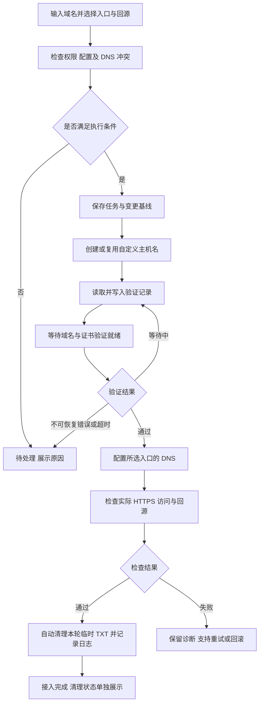

# Cloudflare SaaS自动接入面板需求文档

| 项目 | 内容 |
| --- | --- |
| 项目名称 | Cloudflare SaaS自动接入面板 |
| 文档版本 | v1.5 |
| 文档状态 | 需求整理稿，作为后续设计与开发的依据 |
| 整理日期 | 2026-11-10 |
| 项目形式 | 自部署 Web 管理面板，计划在 GitHub 开源，AGPL-3.0-only |
| 技术栈 | PHP + MySQL |

## 读取已有 SaaS 与纳管补充

- 窄屏下原有与纳管地址记录的三个模式按钮都应完整可见，按卡片排列并标出当前模式；桌面保留 DNS 表格。静态资源随版本更新，避免旧缓存遮蔽新功能。
- 「导入已有 SaaS」用于首次读取、关联及纳管历史配置；日常编辑、模式切换和删除统一在域名管理完成。业务 DNS 所在主域名可以没有 SaaS 默认回源，读取到 404 / 1551 时标记未配置，不当作整个账号失败；权限不足仍显示错误。
- 原有 DNS 不限于展示：支持编辑名称 / 类型 / 内容 / TTL / 代理 / 优先级 / 类型数据及删除、混合批量处理。A / AAAA / CNAME 可切换三种模式；TXT / MX 等保留编辑删除，不使用地址记录模式。
- 用户填写表单、选择模式、勾选批量记录和查看预览期间不得修改 CF。显式确认后才提交执行任务，并在执行前核对原记录；外部变更冲突按项停止，不覆盖或删除其他记录。
- 普通代理切换保留当前内容。进入优选需确定 SaaS、入口及回源，多地址不能自动挑一个；准备验证时保留业务解析，就绪后切换，保留无关 TXT / MX。任务、重试与原值均可审计。

- 域名管理必须载入授权主域名的全部现有 DNS 记录，不限于面板创建或 SaaS 使用的记录；保留各类型内容、TTL、代理状态、优先级及类型专属数据，提供分页、搜索和只读同步。
- 已正常使用的 SaaS / 优选入口按原配置纳管，无标准橙云 CNAME 不作为纳管失败条件。不生成虚构标准入口、不切回标准解析、不新增验证 TXT，不更改业务、共享入口或回源 DNS。
- 确认纳管前重新读取核对原配置；原有主机名、回源与 DNS 保留外部归属。未配置的新建接入目标不能被当作已有域名需要修复的错误。

Cloudflare 账号支持 API Token 或账号邮箱 + Global API Key。邮箱和密钥加密保存，密钥不回显；同方式编辑可留空保留，切换认证方式必须提供新凭据。添加后自动同步主域名并只读发现已有 SaaS，云端写入仍由明确的配置操作与后台任务执行。

- 添加 / 同步账号后自动读取全部已启用 CF 账号，关联业务 DNS、入口 DNS 与 SaaS；Web 重新读取时自动同步授权 Zone。
- 分页读取全部授权范围内的已有自定义主机名、证书 / 验证状态、标准入口、默认 / 独立回源及解析链。明确项自动填好，第三方优选用途和多方案需确认；权限不足、循环、泛域名等不支持项显示需处理。
- 支持每次选择最多 20 条，预览自动填入的方案，确认待定项后逐条纳管；预览不保留本地写入，确认重新核验云端，冲突不覆盖，支持幂等重试与逐条结果。
- 纳管保留原 DNS / 回源 / TXT 与外部归属，先只读检查 CF、DNS 基线及 HTTPS，再判定接入完成。定期检查继续只读；明确编辑 / 模式变更后进入常规管理，原有云端资源不被误认领或清理。
- 多地址源站保留完整预设；同一 CF Zone 的重复凭据不产生假歧义，多个真实关联方案需手动选定。IP 集合返回顺序和 IPv6 文本形式不影响匹配。
- 记录读取错误、纳管来源、关联选择和自动 / 人工确认；支持暂停、刷新后继续及 CF 退避。批次超过 24 小时重新读取，部分失败不能当作完整清单。测速与外部未授权账号内部信息不在自动判断范围。

## 自定义入口补充

- 业务域名统一 CNAME 到 xxx.aaa.com，再由入口指向优选 CNAME 或多个 IP。aaa.com 从授权 Zone 选择，xxx 可自定义，不使用根域名。
- 入口保存为本地计划，由首次使用它的接入任务自动部署，记录读回结果、归属及审计；被引用或部署后禁止直接改解析，使用新入口和记录切换。
- 入口冲突不覆盖，外部完整匹配 DNS 只读复用，外部部分组不接管；自有部分写入可恢复，部署后外部增删改需人工检查。
- 删除业务 / 本地配置保留共享入口 DNS。历史直接目标保留兼容，升级不改写现有解析。导出格式 4 保存入口域名与账号 / Zone 依赖，仍兼容 1 / 2 / 3。

## 简化操作补充

- 日常使用「优选目标」和「域名管理」。目标由入口主域名、自定义前缀、优选 CNAME 或 1 至 10 个 IP 组成。账号管理保留 CF SaaS 服务及历史回源预设，后续扩展 DNSPod。
- 设置入口主域名和自定义前缀，再填写 CNAME 域名或 IP，自动识别并可设为默认；添加记录默认显示名称、源站 IP 和优选入口，自动识别 IPv4 / IPv6。
- 首次选定已同步的 SaaS 站点后自动读取 CF 默认回源，查找已有代理 CNAME；唯一时自动填写，多个时选一次，缺失或权限错误明确显示。读取不得修改 CF，人工补充放在高级设置。
- Web 首次保存接入配置补齐新任务默认 SaaS / 回源；既有记录不因默认项变化而被修改。使用源站 IP 时自动回源，预设和检查项默认折叠。
- 创建记录默认填写回源 IP，再选择优选目标；用户可手动切换为 CNAME 源站，IP 与 CNAME 二选一。当前不包含 IP 故障后自动改用 CNAME 的逻辑。
- 选中 IP 组后在入口主机名下按地址生成 A / AAAA，业务域名 CNAME 到入口，可同时包含 IPv4 / IPv6。源站 IP 不混入该组。手动 CNAME 源站自动创建独立代理别名，支持修改、回滚、清理和导入导出。

## 批量操作补充

- 同一主域名的记录列表增加行复选框、全选本页、清空选择和选择计数，支持跨页选择，每批最多 50 条。更换主域名、搜索或离开域名管理时清空选择，避免误操作隐藏记录。
- 支持批量关云、开小黄云和优选。沿用每条记录的源站与生效入口快照，不因为批量切换而改动其他配置。
- 支持批量删除：默认删除当前匹配的 A / AAAA / CNAME，不恢复旧解析；清理面板创建的 SaaS 主机名、自有验证 TXT 和自动回源，保留无关 TXT / MX、复用主机名及历史。也提供恢复原 DNS / 保留主机名、恢复原 DNS / 清理自有主机名、仅移除面板管理的选择。
- 提交前列出域名、选择时的配置版本、预期操作及逐条检查结果。预览不持久化任务、删除或配置；API 调用审计正常记录。确认只提交预览中可执行的记录。
- 逐条校验主域名归属、配置版本、任务和配置可用性；无变化记录跳过，失败记录单独反馈，其他有效记录继续。外部 DNS 内容或代理状态变化时停止删除，不覆盖新记录。
- 批量请求使用幂等键、统一批次编号及逐条任务编号；排队和云端执行结果区分展示。失败记录保留选择以便处理，成功提交记录清除选择。

验收覆盖预览无残留、选择范围、50 条上限、版本冲突、部分失败、重复提交、实际删除与恢复原 DNS 的区别、外部改动保护，以及 API 权限和审计。

## DNS 模式补充

- 每条记录提供三个互斥按钮：「关云 · 仅 DNS」「开小黄云」「优选」，同时在添加 / 编辑窗口提供选择。
- 关云：A / AAAA 指向填写的源站 IP，`proxied=false`。开小黄云：A / AAAA 指向源站 IP，`proxied=true`，TTL 自动。优选：保留现有 SaaS 接入和所选优选 CNAME / IP 入口。
- 前两种模式需要明确源站 IP，不把 SaaS 代理回源域名当成直连源站。普通 DNS 模式不创建 SaaS 主机名、不执行 SaaS TXT 验证或续期；保存结果以云端 DNS 内容和代理状态读回核对为准。
- 已接入记录一键切换需验证当前配置版本、记录变更快照并支持回滚。只切换模式时，不附带应用后来编辑的入口预设。未完成切换期间仍展示当前生效模式和任务状态。
- 首次切换到优选时自动准备 SaaS 主机名、标准入口与 TXT 验证，成功后应用优选入口并清理 TXT；失败恢复本次 DNS 变更。离开优选保留已有 SaaS 主机名与回源以便恢复，明确移除云端主机名时再按归属清理。
- 导入导出保留模式。历史无模式记录默认优选；基础普通 DNS 导出为格式版本 2，含 CNAME 源站升级为 3，自定义入口升级为 4，旧格式仍可导入。

## 主域名、记录操作、导入导出与版本

1. 默认入口先展示 Cloudflare 同步得到的主域名，支持 `aaa.com`、`bbb.com` 等多个 Zone，并按账号区分同名 Zone。点击后只显示该 Zone 下的接入记录，支持搜索和分页。
2. 添加记录采用 DNS 编辑方式：填写名称（`aaa`、`www` 或 `@`），选择 A / AAAA 源站 IP，或选择回源预设。主域名决定 DNS 账号与 Zone，SaaS、优选入口、访问检查继承默认值，也允许单条覆盖。
3. 例如 `aaa.aaa.com → x.x.x.x` 中的 IP 表示源站。面板自动为它创建独立的 SaaS 代理回源，客户侧 DNS 统一 CNAME 到自定义入口，入口再指向所选优选 CNAME / IP 组。不得将源站 IP 误写成优选访问入口，也不得改动共享默认回源。
4. 已完成接入的记录可编辑源站 IP、回源预设或访问入口，使用现有配置版本保护、访问验证和失败恢复。记录名称变更需新增记录；未完成任务通过详情处理。
5. 自动回源名称按业务域名与源站 IP 隔离。编辑 IP 保留旧回源以支持回滚；完整删除面板创建的云端主机名后清理归属明确的自动回源。只移除本地管理或保留云端主机名时保留其回源。
6. 全量配置及单 Zone 记录可导出版本化 JSON。记录导出保留当前生效值，不把预设后来修改的值冒充已生效值。单 Zone 文件只带记录依赖；全量文件可携带默认配置。
7. 导出不包含 Token、管理员密码、API Key、应用密钥、远端主机名 ID、远端 DNS 记录 ID 或任务运行状态。该功能不替代完整灾备。
8. 导入需绑定已添加、已同步 Zone 的本地账号；先检查预览，再确认导入。预览不保留配置、任务或审计写入，也不调用云端 API。确认后事务创建配置及接入任务；任意条目失败整批回滚。重复记录只有生效配置相同时才复用，不覆盖已有配置。默认不授权替换已有云端 DNS。
9. 应用使用统一语义版本号，并在页面、健康接口、配置接口、CLI 与导出元数据展示。导出格式版本独立管理，不支持的格式拒绝导入。

验收应覆盖 Zone 归属与委托边界、源站与优选 IP 分离、跨账号回源操作、修改与回滚、外部 DNS 冲突保护、导入预览无残留、导入原子性、重复导入及敏感信息排除。
| 首版对接 | Cloudflare for SaaS、Cloudflare DNS API |
| 后续对接 | DNSPod 等 DNS 服务商 API |

本文件描述目标行为和验收标准，不代表相应功能已经实现。文中的首版配套功能、技术默认值和后续规划均单独标注，便于评审时调整。

## 1. 项目简介

Cloudflare SaaS自动接入面板是一个基于 PHP + MySQL 的自部署管理工具，用于简化域名接入 Cloudflare for SaaS 的操作。

管理员配置 Cloudflare 账号、SaaS 接入信息、访问入口和回源后，即可为单个或多个域名创建接入任务。面板自动处理自定义主机名创建、DNS 解析配置、TXT 验证、状态同步和访问检查，并记录执行过程，方便排障和恢复。

访问入口支持公共优选域名或自定义 IP；真实回源支持多个预设，添加域名时选择。首版仅对接 Cloudflare，DNS 服务商接口预留扩展能力，后续加入 DNSPod 等服务商。

项目名称直接说明用途，现阶段以功能和可维护性为主，品牌名及独立 Logo 设计不作为交付要求。

## 2. 已确认的需求

以下内容来自本次讨论中的明确要求：

1. 项目名称为 **Cloudflare SaaS自动接入面板**。
2. 使用 **PHP + MySQL** 开发。
3. 项目准备在 GitHub 公开源码，应具备公开仓库所需的说明和开发文档。
4. 首版只对接 Cloudflare，后续考虑 DNSPod 等 API。
5. 自动配置接入所需的 CNAME 和 TXT 验证记录；选择 IP 入口时在自定义入口名下创建相应的 A / AAAA，业务域名只保留 CNAME。
6. 访问入口可选择公共优选域名或自定义 IP。
7. 支持配置多个回源域名，在接入时选择。
8. 能自动完成的步骤尽量自动完成，减少重复填写和跨平台手工操作。
9. 提供 Docker 部署和 Web 安装向导。
10. 首版提供可供外部程序调用的公开 API，使用 API Key 鉴权。
11. 回源域名可自定义，例如 `dns.xxx.com`、`cn.xxx.com`，保存后可在接入时选择。
12. 验证完成后自动删除本任务创建的临时 TXT 验证记录，记录清理过程及结果。

前面讨论过的批量处理、进度展示、冲突检查、失败重试和操作日志，列为建议随首版交付的配套功能。自动故障切换、多地区测速等列入后续规划。

## 3. 术语与配置关系

| 术语 | 本项目中的含义 |
| --- | --- |
| 接入域名 | 实际提供给访客访问的域名，例如 `app.customer.example` |
| DNS 账号 | 有权修改接入域名 DNS 记录的账号；首版为 Cloudflare 账号 |
| SaaS 配置 | 一组 Cloudflare for SaaS 所属账号、Zone、标准接入目标和默认回源配置 |
| 标准接入目标 | Cloudflare for SaaS 配置中的官方 CNAME 目标 |
| 访问入口 | 接入域名解析指向的目标，可为标准接入目标、公共优选域名或自定义 IP |
| 公共优选域名 | 管理员提供的 CNAME 入口域名，其实际解析可能由外部维护者管理 |
| 真实回源 | Cloudflare 接收访问后，向其转发请求的源站地址 |
| 默认回源 | 某个 SaaS Zone 的 Fallback Origin，属于该 Zone 的共享配置 |
| 独立回源 | 通过 Custom Origin 为具体自定义主机名指定的回源配置 |
| 自定义主机名 | Cloudflare for SaaS 中的 Custom Hostname 对象 |
| 域名所有权验证 | 证明有权将接入域名添加到 SaaS 配置中的验证 |
| 证书验证 | 证书签发前的域名控制权验证，与域名所有权验证分别处理 |
| 接入任务 | 一次域名接入操作，包含若干可恢复的执行步骤 |

社区使用的“公开回源域名”可能指公共优选 CNAME，也可能指真实源站。本项目界面统一使用“访问入口”和“真实回源”，分别保存，避免将两者混为一个字段。

SaaS 账号与 DNS 账号允许相同，也允许是不同 Cloudflare 账号。面板不能仅凭 SaaS 侧权限修改其他账号中的客户域名解析。

## 4. 范围与优先级

### 4.1 首版核心功能

| 编号 | 功能 | 范围 |
| --- | --- | --- |
| CORE-01 | Cloudflare 账号接入 | 保存凭据、读取可访问 Zone、检查执行操作所需权限 |
| CORE-02 | SaaS 配置管理 | 维护 SaaS Zone、标准接入目标、默认回源等信息 |
| CORE-03 | 访问入口管理 | 公共优选域名、自定义 IPv4 / IPv6、默认入口选择 |
| CORE-04 | 多回源管理 | 多个回源预设，域名接入时选择，保存关联关系 |
| CORE-05 | 自动域名接入 | 创建 Custom Hostname，执行验证和 DNS 配置 |
| CORE-06 | 自动 TXT 验证 | 获取验证记录、写入 DNS、等待生效、同步验证结果 |
| CORE-07 | DNS 接口扩展结构 | 首版实现 Cloudflare，保留其他服务商适配位置 |
| CORE-08 | 安装部署 | Docker Compose 与 Web 安装向导 |
| CORE-09 | 公开 API | API Key、权限范围、限流、幂等和接口文档 |
| CORE-10 | 验证记录清理 | 验证成功后自动清理临时 TXT，完整记录日志，续期时重新同步 |

### 4.2 建议随首版交付的配套功能

| 编号 | 功能 | 纳入理由 |
| --- | --- | --- |
| BASE-01 | 管理员登录 | 保护能够修改 DNS 和使用 API Token 的管理入口 |
| BASE-02 | 批量接入 | 减少重复提交，批次内每个域名单独执行 |
| BASE-03 | DNS 冲突检查 | 避免错误覆盖已有解析和验证记录 |
| BASE-04 | 后台任务和进度 | DNS 与证书验证耗时不固定，需要异步执行 |
| BASE-05 | 失败重试和断点继续 | 处理网络超时、API 限流及服务重启 |
| BASE-06 | 一键诊断 | 分辨 DNS、主机名、证书和真实访问各环节的状态 |
| BASE-07 | 操作日志和修改快照 | 可查变更原因，并为回滚提供依据 |
| BASE-08 | 手动回滚 | 在接入或切换失败时恢复本次修改 |
| BASE-09 | 默认配置 | 常用 SaaS、入口和回源可设默认值，简化接入表单 |

### 4.3 后续规划

| 阶段 | 功能 |
| --- | --- |
| 后续迭代 | DNSPod 适配、更多接入模板、配置导入导出 |
| 后续迭代 | 委托 DCV、证书异常提醒、定时入口健康检查、外部修改检测 |
| 后续迭代 | 多地区探针、候选 IP 测速比较、主备入口自动切换 |
| 按实际需求扩展 | 更多 DNS 服务商、细分角色权限、同一域名多源站容灾 |

首版不包含商业套餐、支付计费、公开用户注册、自动全网扫描 IP，也不把多回源选择扩展为同一域名的自动负载均衡。

## 5. 使用角色与主要场景

### 5.1 首版角色

首版按管理员自用或受信任团队内部使用设计。管理员能够管理账号凭据、SaaS 配置、访问入口、回源和域名接入任务。是否支持多个管理员及细分权限，放入后续设计，不作为首版核心依赖。

### 5.2 主要场景

1. **首次配置**：录入 Cloudflare 凭据，读取 Zone，保存 SaaS 配置、常用入口和回源。
2. **单域名接入**：输入域名，选择入口与回源，使用默认账号信息创建接入任务。
3. **批量接入**：粘贴多个域名，统一指定配置，查看各域名进度及失败原因。
4. **故障处理**：查看诊断结果，修复权限或 DNS 问题后继续原任务。
5. **配置调整**：为已接入域名更换入口或回源，保存变更前信息，检查变更结果。
6. **撤销接入**：区分仅移除面板管理记录、恢复解析、删除云端主机名三种操作的影响。

## 6. 功能需求

### FR-01 管理员访问

- 提供登录、退出和修改密码能力。
- 首次部署创建管理员，不能使用公开固定的默认密码。
- 未登录用户不能读取凭据、调用管理接口或执行接入任务。
- 修改配置和执行任务必须校验登录状态及请求来源，防止跨站请求伪造。
- 登录失败应有频率限制；账号密码使用可靠的密码哈希保存。

**验收条件**：退出后直接调用管理接口应被拒绝；数据库不保存管理员明文密码。

### FR-02 Cloudflare 凭据与 Zone 管理

- 支持添加、编辑、停用和删除凭据，使用备注名称区分用途。
- 优先采用 API Token；Token 加密保存，保存后不向页面完整回显。
- 保存或检测时读取可访问 Zone，显示名称、标识和状态。
- 区分“凭据有效”“可读取 Zone”“可写 DNS”“可管理 SaaS”几项检测结果。
- 权限不足时指出具体失败的操作，不能只显示笼统的连接失败。
- 支持 SaaS 与客户 DNS 使用不同凭据；页面只显示当前凭据实际可管理的对象。
- 不允许直接删除仍被配置引用的凭据；停用凭据后相关任务应暂停并显示原因。
- 更新 Token 后，已有配置关联和任务历史保持可追踪。

**验收条件**：只具有 DNS 权限的 Token 不得被标记为已具备 SaaS 管理权限；日志和接口响应均不泄露 Token。

### FR-03 SaaS 配置管理

- 支持多个 SaaS 配置，每组关联明确的 Cloudflare 凭据和 Zone。
- 保存显示名称、标准 CNAME 目标、默认回源和检测状态。
- 检测 SaaS API 是否可用，以及默认回源是否已配置、是否处于可用状态。
- 支持读取已有默认回源；明确提交的配置操作才可修改 Zone 的默认回源。
- 提供默认 SaaS 配置，供接入表单自动选中。
- 添加域名时不能把与 SaaS Zone 本身相同的域名错误创建为 Custom Hostname。
- 外部平台能力不足、配额不足或功能未开通时，应停止相关步骤并提供可操作提示。

**验收条件**：新增一个域名或选择其他回源，不得无提示地改变该 SaaS Zone 其他域名共用的默认回源。

### FR-04 访问入口管理

- 入口支持标准 SaaS CNAME、管理员提供的公共优选 CNAME、自定义 IPv4 和 IPv6。
- 公共域名使用 CNAME，IPv4 使用 A，IPv6 使用 AAAA。
- 支持保存多个入口预设，包含名称、类型、目标、启用状态和备注。
- 首版每个域名选择一个入口预设；IP 预设可包含去重后的 IPv4 / IPv6 地址列表。
- 允许域名级覆盖默认入口，保存最近一次验证时间与结果。
- 检查域名和 IP 格式，拒绝作为访问入口的回环、私网及其他不适用地址。
- 公共优选域名和自定义 IP 必须通过目标业务域名的兼容性检查，不能仅凭 IP 连通就判定接入成功。
- 不内置未经确认的公共优选域名，也不承诺第三方公共入口的长期可用性。
- 是否使用 Cloudflare 代理必须与接入方式匹配，不能因统一开启橙云而导致所选 IP 入口失效。

**验收条件**：业务记录统一显示 CNAME 到自定义入口；入口 CNAME 或 IP 组必须显示实际解析目标和代理状态。

### FR-05 多回源管理

- 支持保存多个回源预设，记录名称、回源主机名、所属 SaaS 配置、启用状态及备注。
- 回源主机名由管理员自定义，例如 `dns.xxx.com`、`cn.xxx.com`；示例名称不代表内置或由项目提供的服务。
- 添加或批量接入时可以选择回源，也可以使用默认值。
- 区分“使用 SaaS 默认回源”和“为该域名指定独立回源”。
- 独立回源按照 Custom Origin 的要求配置；需要的源站 DNS 记录应在可管理范围内进行检查或创建。
- 如需自动创建源站 DNS 记录，管理员应明确提供源站地址，面板不得猜测真实源站。
- 校验所选回源是否适用于当前 SaaS 配置，并检查回源证书、Host 和 SNI 的兼容性。
- 更换单个域名的独立回源只影响该域名；修改共享默认回源时展示受影响域名。
- 首版“多个回源可选”指保存多个预设并为域名选择，不包含同一域名的自动负载均衡。

**验收条件**：两个域名可分别绑定不同的有效回源；账号能力不足时显示原因，不伪装为配置成功。

### FR-06 单域名接入

- 主要输入为接入域名、访问入口和真实回源。
- SaaS 配置、DNS 账号、DNS Zone 等使用默认值或自动匹配，允许展开调整。
- 域名格式统一处理：去除无效空白和末尾句点，统一大小写；国际化域名需有一致的转换和展示规则。
- 自动选择有权限的、与域名匹配最具体的 DNS Zone；若存在多个可用账号候选，要求明确选择。
- 普通主机名为首版基线；根域名按 DNS 服务商实际能力处理，不能直接假定所有服务商都支持根域 CNAME。
- 泛域名接入不作为首版默认能力，需要单独确认 SaaS 能力及验证要求。
- 同一域名不能同时运行两个互相冲突的接入或变更任务。
- 已存在相同配置时返回现有对象和状态；存在其他配置时展示差异，不能重复创建。

**验收条件**：重复点击提交不会生成多份云端主机名或重复 DNS 记录；正常接入可以在默认配置下完成。

### FR-07 批量接入

- 支持一行一个域名，统一选择 SaaS 配置、DNS 账号、入口和回源。
- 提交前展示格式错误、重复项和无法匹配的 Zone。
- 每个域名单独生成任务，单项失败不阻塞其他域名。
- 批次展示总数、排队数、进行中、成功、失败及需处理数量。
- 支持仅重试失败项，保留每次执行的日志和最终结果。
- 批量上限和执行并发可配置，避免一次提交触发 API 限流。

**验收条件**：批次中部分域名权限不足时，其他有效域名仍可继续；成功项不会因批次重试重复执行。

### FR-08 自动配置 DNS

- 统一支持查询、创建、更新和删除 DNS 记录，首版由 Cloudflare 适配器执行。
- 自动配置入口所需的 CNAME / A / AAAA，以及 API 返回的 TXT 验证记录。
- 修改前读取现有记录，检查同名 CNAME 与其他记录冲突、已有多值记录和验证委托冲突。
- 与目标配置一致的记录优先复用，不重复创建，也不将复用记录擅自标记为面板新建。
- 面板自己管理的记录可按任务自动更新；其他已有记录默认进入待处理状态。
- 如管理员在任务预检中选择替换指定冲突记录，后台按已授权范围自动执行，不逐步骤重复确认。
- 记录修改前后值、云端记录 ID 和操作归属，为恢复提供依据。
- 保留原有无关 TXT 值，不覆盖整组 TXT 记录；只有确有冲突的同名记录才进入冲突处理。
- 配置 TTL 和代理状态，保存其真实值；读取 DNS API 成功不等于公共解析已经生效。
- 遇到根域、CNAME flattening 或其他解析形态时，采用适合该方式的诊断规则，不因未返回字面 CNAME 就直接判错。

**验收条件**：原有 SPF 等无关 TXT 记录不受影响；未授权的已有记录冲突不会被自动覆盖。

### FR-09 自动 TXT 验证与证书状态

- 创建或读取 Custom Hostname，分别提取域名所有权和证书签发所需的验证信息。
- 记录名称、类型、值均以 Cloudflare 当前返回内容为准，不硬编码 `_acme-challenge` 或其他记录名。
- 对每条验证记录定位对应的可写 DNS Zone；权限不足或验证名称被委托到不可管理 Zone 时提示具体原因。
- 对需要多个 TXT 值的验证场景分别保留，不能只写入第一条。
- 验证记录尚未返回时等待下一次同步，不能把空记录列表判定为验证通过。
- 写入后自动轮询 Cloudflare 状态，必要时检查公共 DNS 是否能查到预期记录。
- 当验证值发生变化时重新同步，保留变更历史，不反复提交过期值。
- 域名验证、证书验证和证书部署分别展示，不以其中一项成功替代全部成功。
- 按实际能力选择验证顺序：可预验证时先验证再切流；Cloudflare O2O 等需要 CNAME 指向的场景，在预检说明后按所选策略配置接入解析并继续验证，不能永久等待不适用的所有权预验证。
- 默认自动清理已完成验证的临时 TXT，具体归属校验、清理时机、续期重建及日志遵循 FR-16。

**验收条件**：域名和证书分别验证；O2O 流程不会因缺失所有权 TXT 而永久等待；证书仍在签发时不能显示为接入完成。

### FR-10 访问检查与故障诊断

- 单独展示 DNS、Custom Hostname、证书、HTTPS 访问和回源内容的检查结果。
- 请求使用实际业务域名的 Host 和 TLS SNI，校验证书，不以直接请求 IP 代替业务验证。
- 支持配置检查路径、预期 HTTP 状态码，以及可选的响应关键字；未配置内容断言时标注为基础连通检查。
- 保存实际连接 IP、HTTP 状态、连接耗时、TLS 耗时、首字节时间及最近检测时间。
- 对 DNS 不匹配、证书异常、权限错误、验证超时和 Cloudflare 错误响应提供分项说明。
- 检测请求限制协议、端口、重定向次数和目标范围，避免成为任意内网探测或代理入口。
- 标明测试来自面板服务器所在网络；首版检测结果不代表所有用户所在地的体验。
- API 配置成功但真实访问失败时，不得显示为接入完成。

**验收条件**：接口显示证书有效但源站返回错误时，页面能区分证书成功与访问失败。

### FR-11 后台任务、重试与恢复

- 任务由后台执行器处理，Web 请求仅提交、查询或控制任务。
- 刷新页面和关闭浏览器不影响已提交任务。
- 每一步保存状态、开始与结束时间、执行结果和下次检查时间。
- 网络超时、限流和可恢复的服务端错误自动退避重试；遵守服务端返回的重试提示。
- 无效凭据、权限不足、格式错误等问题进入待处理，不进行无意义的无限重试。
- 记录每次外部修改意图及结果；进程在 API 调用后中断时，恢复前先查询云端状态，避免重复写入。
- 使用任务锁避免多个执行器同时修改同一个域名；锁超时应能够恢复。
- 提供暂停、继续和重试。取消只阻止后续步骤，不代表已完成的云端变更被撤销。
- 执行器应有心跳或最近运行时间，便于发现后台任务未启动。

**验收条件**：执行中重启后台进程后，任务能够根据已保存状态继续，且不会重复创建已有对象。

### FR-12 配置变更、回滚与移除

- 修改已接入域名的入口或回源，应产生独立变更记录并保留上一个配置。
- 在改写已有 DNS 之前保存快照，新建对象标注所属任务。
- 首版提供手动回滚，按本次任务实际执行内容恢复；自动故障切换不属于首版。
- 配置切换的访问检查失败后，自动恢复本次变更前的 DNS 与回源；该恢复不同于后续规划中的线路健康自动切换。
- 手动回滚优先恢复最近一次配置变更，保留原始接入；没有配置变更时才按撤销接入处理。
- 回滚前检查当前云端值是否仍与本次写入一致；出现外部修改时停止自动覆盖并说明差异。
- 只删除本任务创建且仍符合归属条件的记录，不删除复用记录和其他域名的共享配置。
- 回滚部分失败时明确列出已恢复和未恢复内容，状态显示为回滚失败或待处理。
- 移除操作应清楚区分：仅移除面板记录、恢复原 DNS、删除对应云端 Custom Hostname。
- 删除云端主机名前检查业务 DNS 和使用关系；不能通过删除共享回源来移除单个域名。

**验收条件**：回滚恢复原记录的类型、值、TTL 和代理状态；云端存在外部改动时不会被静默覆盖。

### FR-13 操作日志与默认配置

- 操作日志记录操作者、域名、任务、步骤、时间、结果和错误摘要。
- 保留云端对象标识和必要的请求关联信息，不记录认证头、Token 或数据库密码。
- 支持按域名、时间、任务状态筛选，并查看单个任务的完整执行过程。
- 默认 SaaS 配置、DNS 账号、入口和回源可分别设置。
- 默认值修改只影响后续新建任务，不能自动改变已有域名配置。
- 已接入域名保存独立生效快照；编辑入口 / 回源预设不隐式切换已有域名，需在域名详情明确提交变更。
- 完整接入模板和导入导出留作后续迭代；首版公开 API 见 FR-15。

**验收条件**：管理员能从失败任务定位具体步骤，并在修复后继续执行；更改默认入口不会批量改写已接入域名。

### FR-14 Docker 部署与 Web 安装

- 提供 Dockerfile、Docker Compose 和配置示例，启动 Web、MySQL 与后台 Worker。
- 应用与 Worker 使用同一构建产物，共享应用配置及加密密钥；数据库与应用私有目录持久化。
- 数据库健康后再启动依赖服务；数据库默认不向宿主公网暴露端口。
- 提供 `/install` 向导，检查 PHP 版本、扩展、目录权限和数据库连接。
- 使用本机 CLI 或容器日志提供的一次性安装口令保护尚未初始化的面板。
- 安装时填写数据库信息、站点信息和管理员密码，自动生成应用密钥、初始化表结构并锁定安装入口。
- 已安装站点不能通过重新打开安装页覆盖数据库、重置管理员或替换加密密钥。
- 非 Docker 环境同样可以使用 Web 安装，提供 Web 根目录与 Worker 启动说明。
- 安装部分失败可诊断并恢复，不能把只创建了一部分表的环境标记为安装完成。

**验收条件**：空数据库可通过向导完成安装；重启容器保留配置与数据；安装完成后重复提交安装请求被拒绝。

### FR-15 公开 API

- 首版提供版本化接口 `/api/v1` 和公开的接口说明，实际管理操作必须通过 API Key 或已登录会话鉴权。
- API Key 可命名、设置权限范围和有效期，并可随时撤销；明文仅创建时展示，服务端仅保存其摘要。
- 至少支持读取配置列表、查询域名、单个或批量提交接入、查看任务、诊断、重试、暂停、继续、回滚及读取日志。
- 账号凭据、管理员和 API Key 管理默认仅向面板管理员开放，不因持有域名写权限而自动开放。
- 采用 Bearer Token 鉴权，区分域名读取、域名写入、配置读取和日志读取等权限。
- 提交接入与变更提供 `Idempotency-Key`；相同键不同请求内容返回冲突，重复请求返回原操作结果。
- 提供分页、统一 JSON 响应、请求标识、明确的 HTTP 状态码和限流信息。
- 长耗时操作返回任务标识，由调用方查询，不让请求等待证书签发。
- 日志记录 API Key 标识、调用来源、操作及结果，不记录完整 Key。

**验收条件**：无 Key、过期或撤销 Key 被拒绝；只读 Key 不能创建任务；重复请求不产生重复接入对象。

### FR-16 验证 TXT 自动清理与续期

- 默认启用验证后自动清理。域名和证书验证完成后，任务自动进入清理步骤；清理结果单独展示。
- 只清理本任务或本面板为该验证创建的 TXT，按记录 ID、名称、类型和值核对归属。
- 复用的原有记录、无关 TXT、其他未完成验证正在使用的值及委托 DCV CNAME 不能被删除。
- 清理前重新读取云端状态和 DNS 记录；如值被外部修改，跳过删除并记录原因。
- 保存每条 TXT 的创建、复用、验证完成、删除、跳过和失败事件，保留快照供审计。
- 删除遇到临时错误应后台重试，显示“接入成功，清理待完成”；不能把删除失败误报为清理成功。
- 首版周期同步已接入主机名和证书状态；续期出现新验证值时自动写入，待本轮完成后再次清理。
- 清理后的历史记录保留在面板，不等于仍存在于 DNS 中；回滚不得无条件重建已过期的一次性验证值。

**验收条件**：验证成功后新建临时 TXT 被删除并有日志；预存记录保留；续期新值可重建；删除失败可重试且页面状态准确。

## 7. 自动接入流程

### 7.1 初始化流程

1. 配置数据库、应用密钥并创建管理员。
2. 添加 Cloudflare 凭据，读取可访问 Zone。
3. 创建 SaaS 配置，检查标准接入目标和默认回源。
4. 保存访问入口与多个回源预设。
5. 设置默认项，确认后台执行器可运行。

### 7.2 域名接入流程

上图为可预验证时的默认路径。O2O 等依赖接入解析的场景，将入口 DNS 配置提前到等待所有权验证之前，证书 TXT 仍单独同步。队列按计划重新检查，不在 Web 请求内持续阻塞。修改已有非托管记录遵循预检中确定的替换范围。

### 7.3 完成判定

接入完成至少需要：云端主机名状态正常、证书状态正常、所选入口解析符合预期，以及实际业务域名的 HTTPS 检查通过。公共优选域名或自定义 IP 还需要确认流量能进入预期 SaaS 配置；无法确认时应保留未完成或待处理状态。

## 8. 状态模型与错误处理

### 8.1 面板任务状态

| 状态 | 含义 | 允许的后续动作 |
| --- | --- | --- |
| 排队中 | 已创建，等待执行 | 执行、暂停、取消 |
| 执行中 | 正在进行当前步骤 | 等待当前步骤完成、请求暂停 |
| 等待验证 | 外部验证或证书部署尚未完成 | 自动检查、暂停 |
| 待处理 | 存在权限、冲突或能力问题，需要修复 | 修复后继续、回滚、取消 |
| 已暂停 | 暂停后续执行 | 继续、回滚、取消 |
| 执行失败 | 达到重试上限或遇到不可恢复错误 | 重试、回滚 |
| 接入完成 | 已满足完成判定 | 诊断、修改、移除 |
| 回滚中 | 正在恢复本次变更 | 等待 |
| 已回滚 | 本次需恢复的变更均已恢复 | 查看结果、重新接入 |
| 回滚失败 | 存在未恢复的变更 | 查看差异、修复后继续回滚 |
| 已取消 | 不再执行后续步骤 | 查看已执行变更、发起回滚 |

任务状态、域名当前管理状态、Cloudflare 主机名状态、证书状态和访问检查状态分别存储。例如一次入口变更失败，不应覆盖该域名此前已接入的历史事实。

### 8.2 常见异常

| 异常 | 预期行为 |
| --- | --- |
| 凭据无效或过期 | 暂停相关任务，提示更新凭据 |
| 可读 Zone 但不可写 DNS | 标明 DNS 写权限不足，不继续创建依赖该权限的变更 |
| SaaS 未开通、能力或配额不足 | 展示云端返回原因，不自动购买或升级套餐 |
| 同名记录冲突 | 展示差异，按预检授权范围处理 |
| 验证记录仍未生成或未生效 | 保持等待，记录最近检查结果 |
| API 限流或临时不可用 | 退避重试，遵守重试时间 |
| 请求超时且无法判断是否写入 | 先查询云端状态，再决定是否重新执行 |
| 公共优选入口不兼容 | 展示诊断结果，允许改用已验证入口或回滚 |
| 回源 Host / SNI 不匹配 | 区分入口成功与源站不兼容，提示检查回源配置 |
| 后台执行器停止 | 面板提示心跳异常，保留任务进度 |
| 回滚时发现外部改动 | 停止覆盖，列出需人工处理的记录 |

## 9. 页面与交互要求

| 页面 | 主要内容 |
| --- | --- |
| 登录与初始化 | 环境状态、管理员初始化、登录 |
| 概览 | 域名数量、运行任务、待处理问题、执行器状态、最近操作 |
| 域名管理 | 域名、SaaS 配置、入口、回源、验证及访问状态、最近检查时间 |
| 添加与批量接入 | 输入域名、自动匹配配置、选择入口与回源、展示预检结果 |
| 域名详情 | 配置关系、DNS 记录、验证记录、证书状态、诊断、历史任务和回滚入口 |
| Cloudflare 账号 | 凭据备注、可访问 Zone、权限检查和停用状态 |
| SaaS 配置 | Zone、标准接入目标、默认回源、能力检测结果 |
| 访问入口 | 公共优选域名、自定义 IP、默认入口、最近检测结果 |
| 回源管理 | 回源预设、关联 SaaS 配置、已关联域名和可用状态 |
| 任务与日志 | 进度、等待原因、错误摘要、重试、暂停、继续和历史记录 |
| 系统设置 | 默认配置、执行参数、管理员密码和运行环境检查 |
| 安装向导 | 环境检测、安装口令、数据库信息、管理员创建及安装锁 |
| API Key 管理 | 创建、权限、有效期、最近使用时间及撤销 |

界面默认中文，使用直接的功能名称。常见接入流程使用默认值，必要配置可展开；正常可自动完成的步骤不增加逐步确认弹窗。等待状态要显示原因和最近更新时间，避免只展示旋转图标。颜色不能作为状态的唯一表达方式。

## 10. 数据需求

以下为概念模型，实际表结构在技术设计阶段确定。

| 对象 | 主要内容 |
| --- | --- |
| 管理员 | 登录标识、密码哈希、状态、登录时间 |
| 云服务凭据 | 服务商类型、名称、加密凭据、启用状态、权限检查结果 |
| DNS Zone | 服务商 Zone 标识、名称、所属凭据、状态、同步时间 |
| SaaS 配置 | Cloudflare 凭据、Zone、标准目标、默认回源、检查结果 |
| 入口预设 | 名称、类型、目标域名或 IP 列表、启用状态、备注 |
| 回源预设 | 名称、回源主机名、默认或独立模式、所属 SaaS 配置、启用状态 |
| 接入域名 | 规范化域名、DNS 账号和 Zone、SaaS 配置、入口和回源、各项当前状态 |
| 接入任务与批次 | 操作类型、域名、阶段、重试信息、锁、调度时间、执行结果 |
| 验证记录 | 验证用途、名称、类型、值、云端状态、最近同步时间 |
| DNS 变更快照 | 服务商记录 ID、归属、修改前后值、执行结果、恢复结果 |
| 诊断结果 | 检查目标、HTTP 和 TLS 结果、耗时、响应断言、检测来源和时间 |
| 操作日志 | 操作者、任务、步骤、结果、脱敏错误摘要和关联信息 |
| 系统设置 | 默认配置、执行参数和执行器心跳 |
| API Key 与请求记录 | Key 摘要、权限、有效期、撤销状态、限流计数及幂等请求结果 |
| 安装与迁移信息 | 安装锁、数据库结构版本、初始化状态 |

数据库统一使用能够保存中文的字符集。时间保存应采用统一时区基准，界面明确展示所用时区。备份和恢复时须同时考虑数据库与凭据加密密钥，不能只恢复数据库后默认凭据仍可用。

## 11. 技术与接口要求

### 11.1 技术方向

- PHP 负责页面、管理接口、云端 API 调用及后台任务。
- MySQL 保存配置、状态、任务、日志和快照。
- 后台执行采用 PHP CLI Worker，提供单次执行模式用于 Cron；Docker 默认启动独立 Worker 服务。
- 首版不要求额外引入 Redis、独立消息队列或 Node.js 运行服务。
- Web 根目录只公开公共入口与静态资源，配置、密钥、日志及数据备份不能被直接下载。
- 技术方案选择 PHP 8.3+、MySQL 8.0+，Docker 默认 PHP 8.4 / MySQL 8.4；使用模块化 PHP、PDO、原生页面及 JavaScript，首版运行不依赖 Node.js 构建或外部消息队列。

### 11.2 模块划分

至少分离账号凭据、Cloudflare for SaaS、DNS 服务商、接入任务、访问诊断和日志快照几个职责。DNSPod 后续只替换客户 DNS 操作部分，SaaS 管理仍通过 Cloudflare 执行。

DNS 适配层应具备列出 Zone、查找匹配 Zone、读取记录、创建记录、更新记录、删除记录和能力查询。能力差异包括代理开关、根域 CNAME、最小 TTL、多值记录及记录标识方式，不能假定所有 DNS 服务商与 Cloudflare 完全一致。

### 11.3 对外调用范围

| 对接对象 | 首版所需能力 |
| --- | --- |
| Cloudflare 账号与 Zone | 验证凭据或实际操作权限，读取可访问 Zone |
| Cloudflare for SaaS | 读取及创建主机名，查询状态、更新配置、按明确操作删除主机名 |
| Cloudflare 默认回源 | 读取状态，按配置操作设置默认回源 |
| Cloudflare DNS | 读取、创建、修改和删除本任务需要的记录 |
| DNS 查询与 HTTPS 检查 | 验证记录及入口解析、证书、访问和回源响应 |

Web 会话与公开 API Key 使用同一业务服务层，分别进行 CSRF 或 Token 权限校验。公开指接口可供外部程序集成，不表示匿名开放控制权限。

## 12. 非功能要求

### 12.1 凭据与访问保护

- 凭据加密保存，加密密钥与数据库分离，不提交到 Git。
- 登录会话采用合理的 Cookie 属性，部署说明要求对外访问使用 HTTPS。
- 接口进行身份、权限、输入和 CSRF 校验；数据库访问使用参数化查询，页面输出进行转义。
- 云端响应和日志脱敏，错误页面不得暴露配置文件、认证头或完整堆栈中的敏感信息。
- 诊断请求限制目标范围，并在解析及重定向后继续检查，避免绕过目标校验。
- 示例数据、截图、Issue 和导出文件不得包含真实 Token、私钥和生产数据库密码。

### 12.2 可靠性与可维护性

- 外部步骤应可重试、可恢复、可追踪；不能依赖浏览器保持打开。
- 同一目标记录更新要避免并发冲突，外部变更应能被发现。
- 数据库变更具有版本管理和升级说明。
- 系统设置默认值、能力限制和配置项有文档，不能散落在代码中。
- 错误信息同时具备用户可读说明与可定位的任务或错误标识。

### 12.3 建议初始运行参数

以下数值为实现阶段可调整的建议默认值，不是 Cloudflare 的官方限制：

| 参数 | 建议默认值 |
| --- | --- |
| 单次批量提交 | 最多 50 个域名 |
| 并发接入任务 | 2 个，同一域名始终串行 |
| 页面进度刷新 | 约 5 秒，页面不可见时降低频率 |
| 验证轮询 | 逐步退避，最长间隔约 5 分钟 |
| 单次 API 超时 | 约 20 秒 |
| 单次临时故障重试 | 有限次数，结合状态查询和服务端重试提示 |
| 验证等待上限 | 可配置，达到上限后进入待处理而非无限等待 |

任务提交后应快速返回任务标识；证书签发、DNS 缓存及平台验证时间不纳入固定完成时限承诺。面板不能把提交成功描述为全流程已经成功。

## 13. Cloudflare 能力边界

### 13.1 域名与证书分别验证

Cloudflare 的域名所有权验证与证书验证使用不同字段。面板需要分别同步 `status` 和 `ssl.status`，并结合 DNS 指向与实际访问进行完成判定。[官方主机名验证说明](https://developers.cloudflare.com/cloudflare-for-platforms/cloudflare-for-saas/domain-support/hostname-validation/)

### 13.2 独立回源与共享默认回源

独立回源应使用符合 Cloudflare 要求的主机名及其代理 DNS 记录，不能把自定义入口 IP 直接当作 `custom_origin_server`。Host、SNI 和可用的重写能力需根据实际配置检查。[官方 Custom Origin 说明](https://developers.cloudflare.com/cloudflare-for-platforms/cloudflare-for-saas/start/advanced-settings/custom-origin/)

### 13.3 标准接入与优选入口

官方标准接入以 SaaS CNAME 目标为基础。公共优选域名和自定义 IP 是本项目提供的入口配置策略，必须实测兼容性，不等同于官方 Apex Proxying，也不能视为任意 Cloudflare IP 都可用于所有 SaaS 配置。[官方初始配置说明](https://developers.cloudflare.com/cloudflare-for-platforms/cloudflare-for-saas/start/getting-started/)、[Apex Proxying 说明](https://developers.cloudflare.com/cloudflare-for-platforms/cloudflare-for-saas/start/advanced-settings/apex-proxying/)

### 13.4 委托 DCV

后续可增加委托 DCV，通过保留验证 CNAME 简化证书续期；它属于证书验证能力，不能替代全部域名所有权验证。启用前需检查同名验证记录冲突。[官方委托 DCV 说明](https://developers.cloudflare.com/cloudflare-for-platforms/cloudflare-for-saas/security/certificate-management/issue-and-validate/validate-certificates/delegated-dcv/)

### 13.5 测速结果的适用范围

Cloudflare 使用 Anycast；不同网络对同一个入口 IP 的访问结果可能不同。首版只标记面板服务器的检测结果，多地区优选作为后续功能。[Cloudflare IP 说明](https://developers.cloudflare.com/fundamentals/concepts/cloudflare-ip-addresses/)

## 14. 验收场景

| 编号 | 场景 | 通过条件 |
| --- | --- | --- |
| AC-01 | 保存有效 Cloudflare Token | 能读取授权 Zone，显示分项权限结果，Token 不完整回显 |
| AC-02 | DNS 账号与 SaaS 账号不同 | 各自使用正确凭据执行，越权操作被拒绝并说明原因 |
| AC-03 | 标准 CNAME 接入 | 自动完成主机名、TXT、证书、DNS 和访问检查 |
| AC-04 | 公共优选 CNAME 接入 | 配置记录正确，使用业务域名验证，兼容性失败时不显示完成 |
| AC-05 | 自定义 IPv4 / IPv6 | 生成对应 A / AAAA，使用正确 Host / SNI 检查，不能只依据 TCP 连通 |
| AC-06 | 多回源选择 | 两个域名可以选择各自的有效回源，不误改共享默认回源 |
| AC-07 | 域名或证书仍待验证 | 显示具体等待阶段，后台继续轮询 |
| AC-08 | TXT 有多个值或已有无关 TXT | 全部必要值保留，无关 TXT 不受影响 |
| AC-09 | 重复提交 | 不重复创建云端对象或 DNS 记录 |
| AC-10 | 现有解析冲突 | 未授权不覆盖，授权后只修改指定范围且保留快照 |
| AC-11 | 批次部分失败 | 成功项继续，失败项独立显示并可单独重试 |
| AC-12 | API 限流、超时或服务重启 | 退避或恢复后继续，未知结果先查询，不盲目重复写入 |
| AC-13 | 证书成功但源站异常 | 分项结果准确，整体不能标记为接入完成 |
| AC-14 | 回滚 | 恢复本次变更，保护复用记录及共享配置 |
| AC-15 | 回滚前存在外部修改 | 检测差异并停止覆盖，展示剩余处理项 |
| AC-16 | 修改默认配置 | 新任务使用新默认值，已有域名配置保持原关联 |
| AC-17 | 未登录访问或读取敏感配置 | 管理操作被拒绝，凭据与私有文件不能被公开读取 |
| AC-18 | DNSPod 扩展评审 | 接入流程通过统一 DNS 能力调用，业务流程不直接绑定 Cloudflare DNS 字段 |
| AC-19 | Docker 启动 | Web、MySQL、Worker 能按依赖启动，数据库和配置持久化 |
| AC-20 | Web 安装 | 空数据库完成环境检测、初始化、管理员创建和安装锁定 |
| AC-21 | 重复安装 | 锁定后拒绝重装，不能覆盖管理员及加密密钥 |
| AC-22 | API 鉴权 | 无效、过期和已撤销 Key 被拒绝，只读 Key 无法写入 |
| AC-23 | API 幂等与限流 | 重复键返回原结果，键与请求不匹配返回冲突，超限请求被限制 |
| AC-24 | 自定义回源 | 可保存并选择 `dns.xxx.com`、`cn.xxx.com` 等合法主机名 |
| AC-25 | TXT 自动清理 | 本轮验证完成后删除面板新建临时记录，并记录删除日志 |
| AC-26 | TXT 归属保护 | 复用记录、无关值及仍有验证使用的值不被删除 |
| AC-27 | TXT 删除失败 | 显示清理待完成，后台重试，不误报成功 |
| AC-28 | 证书续期 | 同步新验证值并重新创建 TXT，完成后再次清理 |

最终联调需要有权限的 Cloudflare 测试账号和测试域名。没有真实账号时，可以使用模拟响应验证任务逻辑，但不能据此宣称真实 SaaS 接入已经验收通过。

## 15. 公开源码交付要求

正式公开仓库前应包含：

1. README：项目简介、当前实现状态、功能范围、环境要求、部署方式和文档入口。
2. 许可证：已确定 AGPL-3.0-only，署名 Sigusama and contributors；允许商业使用，保留版权 / 许可声明，分发及修改遵守相同许可与对应源码要求；修改后网络服务应向远程用户提供源码获取方式。
3. 部署文档：数据库初始化、应用密钥、管理员创建、后台任务启动、Web 根目录和升级方式。
4. 配置示例：只包含占位值，解释每个必要配置项，不提供可用生产凭据。
5. Cloudflare 配置说明：SaaS 开通前提、Token 权限、访问入口和真实回源的配置关系。
6. 贡献指南、问题反馈模板、安全问题反馈方式和版本变更记录。
7. 自动化检查：覆盖关键状态流转、DNS 冲突保护、幂等恢复及回滚逻辑；检查实际代码而非仅检查示例。
8. 忽略规则：排除环境密钥、运行日志、数据库备份、依赖缓存及本地测试运行时。

README 的“已支持”只列出实际完成并验证的功能，未完成内容放入路线图。文档说明这是独立公开源码项目，避免造成 Cloudflare 官方产品或官方合作关系的误解。

可用于 GitHub 仓库简介的文本：

> 基于 PHP + MySQL 的 Cloudflare for SaaS 自动接入面板，支持自动 DNS 配置、TXT 验证、公共优选域名或自定义 IP，以及多回源管理。

## 16. 实施顺序

| 阶段 | 交付目标 |
| --- | --- |
| 第一阶段 | 更新需求，编写 README、技术方案、API 说明与目录规划 |
| 第二阶段 | 管理员、数据库、凭据加密、Cloudflare 账号和 Zone 读取 |
| 第三阶段 | SaaS 配置、访问入口、多回源预设和单域名接入 |
| 第四阶段 | TXT 自动验证与清理、DNS 切换、后台任务、实际访问检查 |
| 第五阶段 | 批量接入、冲突处理、重试恢复、日志快照和手动回滚 |
| 第六阶段 | Docker、Web 安装、公开 API、真实测试域名联调及首版发布准备 |
| 后续阶段 | DNSPod、委托 DCV、健康检查及其他规划功能 |

## 17. 技术设计前需要确定的事项

这些事项不阻碍本需求文档整理，确定后再形成具体技术方案：

| 事项 | 当前建议或状态 |
| --- | --- |
| PHP 方案 | 技术选型：PHP 8.3+，模块化服务层，PDO，首版不依赖 Composer 包 |
| MySQL 最低版本 | 技术选型：MySQL 8.0+，Docker 默认 8.4 |
| 前端方案 | 技术选型：PHP 页面、原生 CSS / JavaScript，无 Node.js 运行依赖 |
| 主要部署环境 | Docker Compose 为推荐方式，兼容普通 PHP / MySQL Web 安装 |
| 首版后台执行方式 | CLI Worker，支持单次执行供 Cron 使用 |
| 公共优选入口来源 | 由管理员提供，后续联调时确认实际可用目标 |
| Cloudflare 测试资源 | 真实 Token、SaaS Zone、DNS Zone 和测试域名在联调时配置，不写入公开仓库 |
| 多回源的独立配置能力 | 使用测试账号验证实际可用能力、Host / SNI 行为和源站证书匹配 |
| 许可证及版权署名 | 已确定 AGPL-3.0-only；Copyright © 2026 Sigusama and contributors |
| GitHub 仓库地址 | 待创建或提供，建议仓库名 `cloudflare-saas-panel` |

## 18. 需求变更规则

新增 DNS 服务商、自动切换、测速探针及公开用户体系等需求，应先补充目标行为、影响范围和验收条件，再调整版本计划。已确认新增 Docker、Web 安装、公开 API、自定义回源和验证后 TXT 自动清理；核心方向保持为 PHP + MySQL、自部署、Cloudflare 优先和尽量自动化。
