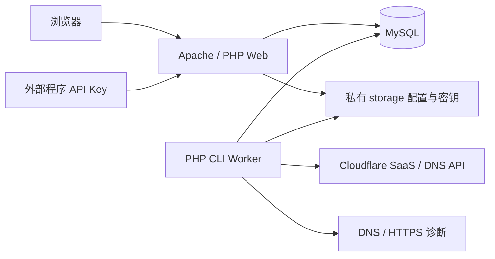

# 技术方案

对应应用版本 `0.1.0-beta.20`。本页说明当前代码的模块职责、数据与任务设计；功能概览见 [README](../README.md)，接口约定见 [API](API.md)，实际验证范围见 [验证状态](IMPLEMENTATION_STATUS.md)。

## 源码目录

| 路径 | 职责 |
| --- | --- |
| `app/Core`、`app/Auth` | 配置、数据库、加密、会话、API Key、权限与幂等 |
| `app/Cloudflare`、`app/Dns` | Cloudflare 客户端与 DNS 适配接口 |
| `app/Services` | 配置生命周期、域名接入、DNS 操作、纳管与导入导出 |
| `app/Jobs`、`app/Http` | Worker 状态推进、路由与请求处理 |
| `bin/console.php` | 安装口令、迁移、Worker 与环境检查 |
| `database/migrations` | 编号 SQL 迁移，升级按序应用 |
| `public`、`resources/views` | 唯一 Web 根目录、静态资源与 PHP 模板 |
| `docker`、`compose.yaml` | Web / MySQL / Worker 部署配置 |
| `tests` | MySQL 集成、HTTP、账号筛选与模拟 Cloudflare 检查 |
| `scripts/package.ps1` | 白名单源码打包与摘要 |
| `storage` | 私有持久配置、密钥与日志，内容不提交 |
| `work`、`release` | 本地工具、测试数据与源码包，不进入 Git |

API 与页面调用同一服务层。Cloudflare for SaaS 与客户 DNS 操作分离；新增 DNS 服务商应扩展适配器，保留现有接入状态机。

## DNS 账号来源与主域名切换

ZoneRecords.zones 接受可选 accountId，在原有账号未删除条件后追加参数化账号筛选。未传参数继续读取全部账号；HTTP 的 account_id 必须是正整数，未知或已删除账号返回空列表。停用账号的域名仍可读取，写入继续由既有 Zone / 账号状态校验保护。筛选不改变 API Key 原有权限。

Web 保留全部授权 Zone 的缓存，用本地 account_id 筛选账号和主域名选项。两个入口共用同一组控件，不按域名名称合并来源；重名账号附加本地 ID。切换账号清空批量选择，跨账号时返回该账号的概览；切换 Zone 沿用 hash 导航重置记录状态，历史导航自动对齐账号。轮询仅在选项变化时重建 select，保留用户当前选择。

## 原有 DNS 修改与优选转换

迁移 009 增加 dns_operations。列表为原有记录返回 cf: 标识和指纹，BulkRecords 支持与整数纳管 ID 混合提交，逐项校验。DnsRecordInput 验证字段，DnsOperations 预览只 GET 核对，不写 CF、不创建可执行任务；确认后持久化原值、目标和执行选项，由 Worker 在操作锁与 Zone 锁下执行。执行前再次核对原值，先记录 write_planned，再按记录 ID PATCH 或 DELETE，读回确认并更新快照。响应丢失时检查目标是否已生效，保留其他字段，不盲目重复请求。参见 CF 官方 [PATCH 记录](https://developers.cloudflare.com/api/resources/dns/subresources/records/methods/edit/) 与 [删除记录](https://developers.cloudflare.com/api/resources/dns/subresources/records/methods/delete/)。

DnsPreference 为普通 A / AAAA / CNAME 准备优选计划：已有 SaaS 复用只读纳管，新记录在确认后保存本地原 DNS 配置，再委托 DomainChange。批准的完整同名 RRset 写入任务上下文，change_precheck 在创建任何云端资源前再次核对。preserve_dns_until_ready 使验证阶段保留原业务解析，用 CF 返回的 TXT 验证信息等待就绪，再切换目标。没有标准 CNAME 时不虚构入口。同名多个地址必须明确源站并确认完整替换范围；保留非地址类型，NS 委派单独阻止。观察的完整地址组随原配置保存，用于回滚恢复原 TTL、类型和代理状态。

原有记录操作状态在列表、任务详情和审计中提供；确认只是排队，不标记云端已经修改。普通失败可重试，外部变化始终要求重新核对。预览、表单修改、模式选择和取消都不会产生云端写入。Demo 的 Worker 在执行队列前退出，不得将真实凭据填入 Demo。

TXT 预验证期间保留路由的依据见 CF 官方[主机名验证](https://developers.cloudflare.com/cloudflare-for-platforms/cloudflare-for-saas/domain-support/hostname-validation/)：主机名所有权和证书使用不同验证字段，原 SaaS 流量在 DNS 目标切换前保持原路由。

## 全部 DNS 与已有优选配置

迁移 008 增加 zone_dns_snapshots。ZoneDns 只发起 GET，分页完整读取全部 DNS 类型后原子替换本地快照；保留 MX priority、CAA / SRV / HTTPS data、TTL、代理、注释等字段。失败、重复 ID 或超出 50000 条 / 8 MB 上限不替换最后完整快照。已有 SaaS 扫描完成 DNS 分页时也写入此快照。

ZoneRecords 的 include_existing=1 返回原有记录和已纳管域名。原有记录使用 cf: 前缀 ID，与本地整数域名 ID 区分；纳管域名聚合所属 A / AAAA / CNAME，其他同名类型仍独立显示。原有字段和 observed_dns_records 来自读取快照，旧公开 API 默认继续返回接入计划，避免改变已有客户端。Web 首次打开未加载的主域名自动读取，支持手动同步；已完成本地变更比快照更新时重新读取，并限制自动重试频率。

已有优选纳管不依赖标准橙云 CNAME。没有候选时 profile.cname_target 为空，仍保存真实优选入口和回源基线，不虚构域名。SaasAdoption 只为存在的标准候选做额外校验；业务、入口、回源、远端主机名和 SNI 的变化保护保持。仅明确新建接入时要求可用标准入口；旧域名的只读检查不触发创建或切流。导出格式 5 表示含此类配置，同安装复用；新安装须先读取并纳管原域名，文件不能绕过确认创建云端资源。

## Cloudflare 账号认证

迁移 007 增加 accounts.auth_type，旧账号默认为 api_token，不改写已有密文。CloudflareCredential 校验并封装凭据：API Token 保留原明文结构后加密；global_key 将邮箱与密钥封装在同一个 JSON 后加密至 token_encrypted。Cloud 将其转换为客户端参数，Token 发送 Authorization: Bearer，Global Key 发送 X-Auth-Email 与 X-Auth-Key，禁止混用。网络、HTTPS 和超时策略保持一致，云端错误同时脱敏邮箱和密钥。

账号列表只返回认证方式；管理员会话专用 auth 接口为编辑返回邮箱，不返回密钥，公开 API Key 无法访问。编辑同一方式时空密钥保留旧值，变更认证方式必须填写新凭据；改变邮箱或密钥会重置 checked_at，未改变则保留原密文与检查时间。导入导出不携带认证凭据，删除未引用账号时清空密文。

## 已有 SaaS 读取与纳管

迁移 006 增加 discovery_runs / discovery_zones / discovery_items，以及 origins.external_dns_json、domains.adopted。SaasInventory 保存可恢复游标，每个 step 最多一次 CF GET，分页读取授权 DNS、fallback_origin、custom_hostnames，最后每步关联 100 条。扫描锁独立于 Worker 操作锁，失败与退避时间持久化，局部错误不会冒充空的成功清单。输出仅保留所需的 CF 状态字段，忽略原始 SSL 和自定义元数据。

默认回源查询返回 404 / CF 1551 时表示该 Zone 未配置 SaaS，fallback_status 为 not_configured，继续读取 DNS / 主机名且不产生账号错误。403 等权限错误继续保留；有关联主机名却缺少必需回源时仍由关联分析标记需处理。手动读取单个 SaaS 服务返回明确的 saas_not_configured，普通 DNS 管理不受影响。该页面仅负责历史配置导入，日常操作使用域名管理。

DNS 表格在 720px 以下改为带字段说明的记录卡片，三个模式及编辑删除完整展示。原有记录与纳管记录共用模式颜色。PHP 模板给 CSS / JS 附加 VERSION 查询参数，升级后重新获取资源。

InventoryLinks 按最具体的授权 Zone 建索引，关联业务记录、标准 CNAME、自定义入口、后续 CNAME 链及显式 / 默认回源。相同 CF Zone 和 DNS 通过重复凭据读取时合并，不同 Zone 的同名记录保持歧义。IP 集合比较忽略排列，IPv6 使用规范化 / 二进制等价比较。外部目标作为边界，不把解析当作速度证据；循环、缺权限和不支持的结构明确列出。

SaasAdoption 接受快照 key 和候选选择，预览事务回滚所有本地写入；确认先重新 GET 校验配置未变化，再在全局操作锁内创建配置 / 域名 / inspect 任务。新入口以 applied 只读 DNS 基线保存，原源站通过 external_dns 保存观察身份，不创建 owned managed_sources。已有相同记录可复用，旧生效快照不同则拒绝覆盖。标准 CNAME 存在多个合法别名时复用本地已确定的服务配置，并保留业务原有别名。

AdoptedDomain 只读检查远端主机名、回源 / SNI、DNS 基线及 HTTPS；云端 active 与应用 active 分开。原记录的定期检查排队 inspect，不创建或清理历史 TXT。ManagedOrigin 对 external_dns 执行只读比对，独立源站修改才创建新的自有别名。首次纳管只补齐空的全局默认值，默认回源使用共享 fallback 预设，原有默认选择保持。

明确配置切换通过后 adopted=0，沿用原 DomainChange 失败恢复及回滚；原有 CF 主机名的 hostname_created 始终为 0，外部源站不进入自有资源清理。纳管本身无“接入前改写”，所以无变更历史时不能撤销原始接入。导出是接入计划，排除观察基线与归属；同值本地回导保留原源站，跨安装接管使用重新读取 / 纳管。

## 简化接入与配置发现

beta.11 优选链路为业务域名 CNAME → 自定义入口 → 优选 CNAME / IP 组。Web 从已授权 Zone 选择入口主域名，填写前缀及目标，默认自动命名。账号管理包含 CF 账号与 SaaS 服务设置，DNSPod 接口尚未实现。

迁移 005 为 entries 增加 zone_ref / 唯一 hostname，并增加 entry_routes 保存 DNS 部署意图及读回快照。EntryAlias 统一校验名称归属、冲突与本地 CNAME 循环；入口 DNS 使用自身 Zone 的账号，可与业务 DNS / SaaS 账号不同。生效快照保存 DNS 账号和 Zone，导出转换为可绑定的账号引用与 Zone 名称。

Worker 首次预检和应用业务入口前核对共享入口；域名切换与恢复也复查目标入口。先持久化计划，再读现有 DNS，写入带 entry 归属标记的记录，读回完成后提交 applied。自有部分写入可恢复，完整匹配的外部 RRset 只读复用，外部冲突或部分组停止处理。部署后对比记录 ID、内容、代理、TTL 与 comment；发现外部增删改停止覆盖。共享入口不随业务域名或本地配置删除。

有引用或部署计划的共享入口禁止修改解析身份 / 目标，改用新入口和单记录变更，防止共享 DNS 绕过生效快照和回滚。历史未绑定域名的直接目标保留兼容。IP 组最多 10 个，混合 IPv4 / IPv6 发布在入口名下，业务侧只生成一条 CNAME。

回源默认 IP，手动 CNAME 使用 source_hostname；ManagedOrigin 为两者生成独立代理别名。迁移 004 保留旧 IP 哈希与快照，普通 DNS 直接使用源站，优选才创建 SaaS 回源别名。导出格式按依赖升级为 1 / 2 / 3 / 4 / 5，格式 4 保存共享入口及单 Zone 跨账号依赖，格式 5 补充标准目标为空的已有 SaaS 配置。

`SaasDiscovery` 先验证本地账号 / Zone 归属，再只读 CF fallback_origin 和该 Zone 的代理 CNAME。只接受直接指向默认回源且属于该 Zone 的普通主机名。没有结果时不凭空生成 DNS，有多个时不猜选；不在发现请求中写 CF 或本地配置。异步读取使用修订号，切换站点或退出编辑后的旧响应不回填表单。Demo 只读本地预设。既有回源预设仍可供高级用户手动选择。

登录 Cookie 名称由安装密钥派生的摘要区分，首次安装前使用私有目录作为命名空间，同时核对会话内的安装标记，拒绝仅改 Cookie 名称重放其他安装的会话文件。演示 Worker 在操作锁之外更新心跳并退出；正常 Worker 取得锁后再次核对 preview_mode，再执行任务。

## 批量操作

`BulkRecords` 接受同一 Zone 下 1 至 50 个显式记录 ID 和 expected_version，拒绝重复、缺失版本及非整数标识。预览与提交使用同一服务校验，每条记录独立保存点，应用层错误转为逐项结果，不吞掉数据库等意外故障。预览通过回滚保存点移除任务、配置、审计与本地删除写入；不调用云端 API。

API 外层沿用操作互斥锁、权限、CSRF、限流和幂等事务。确认后只提交预览可执行项，后台仍逐项重查版本与未完成任务。返回 summary / items 区分 ready、unchanged、queued、removed、failed；queued 只表示任务受理。每个新任务的 context_json 加入 batch_id，审计包含批次汇总与逐项记录。

`delete_records` 与旧的 restore / delete_remote 分开处理。Worker 校验当前 A / AAAA / CNAME 仍匹配生效目标，再通过 DNS 意图日志删除；不回放旧解析。删除后读回确认，发现新记录或外部改动则保留并停止归档。删除自身验证记录仍按归属和共享使用检查，不删除无关 TXT / MX；只清理明确由面板创建的 SaaS 主机名，复用资源保留。

选择信息由前端按主域名保存在内存，跨页保留原始版本，不随后台刷新悄悄更新确认基线。切换主域名、提交搜索或离开域名页面清空选择。网络重试保留原幂等键，成功提交后只保留失败选项。无需新增数据库迁移。

## DNS 模式

DNS 模式保存在 `applied_config.dns_mode` 及变更快照中，不额外增加数据库列；历史缺省值为 `preferred`。`DnsMode` 统一校验、生成 DNS 目标并读回验证：`dns_only` 写源站 A / AAAA、关闭代理；`proxied` 写源站 A / AAAA、开启代理和自动 TTL；`preferred` 使用已有优选入口生成规则。

普通 DNS 的 Worker 跳过 SaaS 接口，保存后验证记录内容与代理状态，不强制 HTTPS 访问或 SaaS 证书。已有记录通过 DomainChange 记录基线和回滚；目标为普通 DNS 时跳过 SaaS 回源修改，保留原主机名与代理回源。只切换模式使用旧的生效入口、回源和检查快照，避免同时应用预设的新修订。

普通记录首次进入优选由 `SaasProvision` 补齐主机名与 TXT 处理，经过 `change_provision`、`change_validation` 后再进入回源、入口和访问验证。失败恢复普通 DNS，保留已创建的 SaaS 资源以供重试或明确移除；无法确认创建归属的主机名不自动删除。优选续期任务排除普通 DNS 记录。

基础优选导出为格式 1；普通 DNS 升级为 2，CNAME 源站升级为 3，自定义入口升级为 4，含无标准入口的已有 SaaS 配置升级为 5；导入支持 1 至 5，按字段拒绝低版本，避免丢失语义。

## 主域名记录与可移植配置

`ZoneRecords` 使用本地 Zone ID 展示分组，以 `account_id + cf_id` 限定记录查询。记录写入仍由 `DomainService` 完成，并复查最具体的 Zone，避免父 Zone 接管已委托子 Zone。A / AAAA 是表单中的源站类型；实际访问 DNS 由入口配置生成。

迁移 `003_zone_records.sql` 为 origins 增加 `source_ip`，并创建 `managed_sources` 意图与归属表。`ManagedOrigin` 为每个业务域名与源站 IP 生成稳定的 `src-<hash>.<saas-zone>` 主机名，在 SaaS 账号中创建橙云 A / AAAA，然后将其作为独立回源。访问 DNS、验证 TXT 与回源 DNS 使用各自账号，不混用 DNS 撤销日志。自动回源不出现在共享预设列表。

源站 IP 与自动主机名进入不可变生效快照。修改源站生成新的回源，旧记录保留以供恢复；未知创建响应通过唯一归属 comment 对账。外部创建、修改、删除的回源记录触发人工处理，不接管。移除云端主机名后，才清理本域名的自动回源；保留主机名时保留回源。

`Transfer` 导出格式为 `cf-saas-panel`，按配置依赖使用 `format_version=1` 至 `5`。文件通过 ref 表达本地配置依赖，导入绑定本地账号并按 Zone 名匹配已同步的云端 Zone，不复用文件中的远端 ID 或凭据。单 Zone 导出裁剪依赖，全量导出允许恢复默认值；各记录使用其 applied_config 中的入口与回源值。

导入由全局操作锁与数据库事务保护。预览执行同样的本地校验与写入逻辑后整体回滚，配置、任务与日志不留存；确认提交后才由 Worker 异步调用云端 API。自动递增 ID 在预览后可能跳号，这是 MySQL 的正常行为。任何记录错误导致整批回滚；已有记录按实际配置比较，冲突不会被覆盖。导入不授权替换远端 DNS，冲突任务需另行处理。

`VERSION` 为应用版本唯一来源，`Version::current()` 供页面、API、CLI、导出读取。导出格式版本独立于应用版本。预览库可通过私有 setting `preview_mode=1` 禁止 Worker 执行云端步骤，并在页面显示 Demo 标识；演示 Worker 不获取操作锁，仍更新心跳，正常安装不设置此值。HTTP 测试在生成模拟任务前显式设置该隔离标志。

## 1. 技术选型

| 层次 | 方案 | 理由 |
| --- | --- | --- |
| 应用 | PHP 8.3+，模块化 PHP 服务 | 同时支持 Docker、常见虚拟主机与 Web 安装，无框架发布包依赖 |
| 数据库 | MySQL 8.0+，PDO，utf8mb4 | 配置、任务、审计和快照统一持久化 |
| 界面 | PHP 模板、原生 JavaScript、CSS | 无前端构建步骤，安装后可直接运行 |
| 云端访问 | cURL、HTTPS、固定 Cloudflare API 基址 | 支持超时、错误分类及测试替身 |
| 凭据加密 | OpenSSL AES-256-GCM | 应用密钥与数据库分离，认证加密防止密文被静默篡改 |
| 后台任务 | MySQL 任务表 + PHP CLI Worker | 免 Redis，任务可恢复，支持常驻与单次运行 |
| 部署 | PHP 8.4 Apache 镜像 + MySQL 8.4 + Worker | Web 根目录固定 public，后台与 Web 使用相同产物 |
| 测试 | 无外部依赖的 PHP 测试脚本 + MySQL 集成测试 | 覆盖真实状态流转，模拟云端 API，避免改动真实 DNS |

不把“无框架”理解为页面混写业务：路由、控制器、服务、云端适配和数据访问分别承担职责。后续如迁移框架，应保留服务与适配器边界。

## 2. 部署拓扑



Web 只处理交互和短时配置查询，长任务放入队列。Docker 数据库使用健康检查，Worker 安装前等待，安装完成后执行任务。Web 和 Worker 共享 storage，数据库使用独立持久化卷。

## 3. 核心模块

- Core：配置、数据库、路由、会话、加密、输入规范化与异常处理。
- Install：环境检测、一次性口令、数据库迁移、管理员创建和安装锁。
- Auth：会话认证、CSRF、密码、API Key 摘要、权限范围、限流和幂等。
- Cloudflare：固定 API 基址、响应解析、错误分类和分页。
- DNS：统一适配接口，首版实现 Cloudflare，未来实现 DNSPod。
- Onboarding：预检、接入任务、验证同步、入口切换、清理和恢复。
- Diagnostics：安全解析、TLS / HTTP 与内容断言。
- Audit：云端变更意图、记录快照、操作日志和 TXT 生命周期。

## 4. 安装与配置

1. CLI 或 Docker 入口在 storage 中生成一次性安装口令摘要；明文只输出到管理员终端或容器启动日志。
2. `/install` 显示运行条件，并验证口令与 CSRF。
3. 验证数据库连接，使用数据库安装锁防止并发初始化。
4. 以可重复执行的迁移创建表，检查数据库不是已有站点后创建管理员。
5. 原子写入私有配置文件与随机应用密钥，写入安装锁，撤销安装口令。
6. 后续安装提交一律拒绝。数据库迁移与重装分离，不通过安装页重置管理员。

Docker 中 DB 参数来自环境，Web 向导仍可检测并填写；共享私有配置保存实际安装结果。配置文件不位于 public，也不通过 API 返回。

## 5. 数据设计

使用专用表保存 users、accounts、zones、profiles、entries、origins、domains、jobs、verification_records、dns_changes、entry_routes、managed_sources、domain_changes、audit_logs、settings、api_tokens、api_rate_limits 和 idempotency_requests。表结构由编号 SQL 迁移维护。

002 迁移增加配置删除标识、domains.applied_config / config_version，以及 domain_changes。旧域名在迁移时保存已有配置快照；预设编辑只改变预设，域名继续使用生效快照。引用中的配置不能删除，停用会暂停相关待执行任务；恢复步骤使用历史快照，不依赖被停用的新目标。

关键约束：规范化域名唯一；记录托管归属明确；API Key 只保存摘要；云端凭据加密；配置对象被引用时不得直接删除。任务保存持久化阶段和上下文 JSON；日志和状态分别保存，避免解析日志来恢复任务。

主机名状态与证书状态分别保存。域名另有诊断和清理状态，“业务可用、清理失败”可以同时表达。

## 6. 接入状态机

```text
precheck → hostname → verification → waiting → routing → diagnose → cleanup → completed
                          ↑             │
                          └─ 轮询 / 续期 ┘
```

预检确定标准接入或兼容性入口策略。CF DNS 首版检测 O2O：所有权依赖 CNAME 指向时先配置所需标准路由，证书 TXT 单独写入；支持所有权预验证的场景再采用先验证后切流。对于优选入口，必要时先完成标准路径，再应用目标入口并复检，不能把“改成优选 IP”当作独立的所有权证明。

Cloudflare 官方明确 O2O 不支持所有权预验证，证书验证仍是另一项能力。[所有权预验证说明](https://developers.cloudflare.com/cloudflare-for-platforms/cloudflare-for-saas/domain-support/hostname-validation/pre-validation/)

Worker 每次推进一个可持久化步骤。相同域名保持串行，外部调用前写变更意图，调用后写结果；重启时查询远端并对账。使用 MySQL 互斥锁保证首版多个 Worker 不重复执行；请求端只调度，不直接运行步骤。

DomainChange 独立处理已接入域名变更：保存 DNS / 远端回源基线，应用回源和入口，验证新配置，最后提交快照及版本。检查失败转入恢复阶段，只恢复该变更 job_id 对应的 DNS 与回源；外部修改导致无法安全恢复时显示 rollback_failed。

未知 API 结果先对账。云端主机名创建响应丢失后，若只能查询到匹配对象，按归属不明的复用对象处理，不擅自声明为面板创建，避免后续误删除。

临时故障退避重试，权限与冲突进入 needs_attention，验证未完成进入 waiting。取消不等于回滚，回滚作为独立任务倒序恢复已完成变更。

## 7. 多回源与入口

入口和真实回源分表保存。公共优选 CNAME 和自定义 IP 属于入口；`dns.xxx.com`、`cn.xxx.com` 等合法主机名可作为管理员自定义的回源预设。

默认回源是 Zone 共享配置，单域名接入不能反复改写它。独立回源使用 Custom Origin，检查主机名、代理记录、Host / SNI 和账号能力；不满足时提示并停止该配置，不自动放宽 TLS 校验。

## 8. TXT 清理与续期

验证记录保存用途、云端 ID、名称、值、创建归属和本轮验证标识。`created` 与 `reused` 明确区分。

清理前重新读取 Custom Hostname，确认所有权和证书状态；只删除自己创建、当前内容未改变、没有其他等待任务引用的 TXT。无关值和委托 CNAME 保留。每条创建、复用、删除、跳过与失败动作写入审计。

清理出错单独重试，不能把清理失败解释为证书失败。续期同步器定期读取已接入主机名，获取新 TXT 后重新写入，完成本轮验证后清理；不能只删除首轮记录而不处理后续订单。[Cloudflare TXT 与续期说明](https://developers.cloudflare.com/cloudflare-for-platforms/cloudflare-for-saas/security/certificate-management/issue-and-validate/validate-certificates/txt/)

## 9. API 设计

`/api/v1` 为公开集成接口，Bearer Key 鉴权；Web 会话走同一服务层，写操作校验 CSRF。API Key 具有 `domains:read`、`domains:write`、`config:read`、`logs:read` 权限，不默认允许管理账号密钥。

限流以 Key 和时间窗口计数，返回 429 与 Retry-After。写入接入请求可携带 Idempotency-Key，存储请求指纹与响应；相同键不同内容返回 409。幂等请求与本地创建任务在同一数据库事务完成。

幂等指纹包含方法、路径与规范化 JSON，适用于创建、切换、控制及移除。嵌套事务使用保存点，批量提交逐项隔离错误，域名唯一约束对并发重复进行对账；锁冲突返回可重试错误。

详细路径、响应与示例见 [API 说明](API.md)。

## 10. 运行保护

配置与日志私有；禁止公网直接下载 storage、.env 和数据库备份。会话登录有限流，使用密码哈希、CSRF、输出转义及参数化 SQL。服务端 HTTPS 检查保持实际业务域名的 TLS 验证，限制公网解析目标且不自动跟随重定向进入内网。

日志不输出 Cloudflare Token、API Key、数据库密码及认证头。应用密钥丢失无法解密旧凭据，备份说明须同时涵盖配置与数据库。

## 11. 交付验证

按安装、API 权限、DNS 冲突、幂等、状态恢复、TXT 归属清理与回滚编写可执行测试。使用真实 MySQL 测试迁移和事务；Cloudflare 请求使用可注入测试替身。没有授权测试账号时只报告模拟集成结果，不声称真实域名接入已完成。

Docker 需要在具备 Docker Engine 的环境验证 `docker compose config`、构建、空库安装、容器重启和持久化。当前机器缺失的运行条件须列入开发进度，不能用文件存在代替运行验证。

容器启动前自动迁移，Web 与 Worker 均有健康检查。CI 调用 tests/docker-smoke.sh，在独立项目中验证安装、API、重启持久化与 MySQL 集成，清理范围限定在测试项目。

## 12. 多语言与镜像交付

`I18n` 依据受支持的 Cookie 或浏览器语言选择 zh-CN / en，PHP 模板只翻译系统文本。浏览器 `L.tpl` 将插值作为不透明参数，在翻译字面文本后原样还原；域名、账号名和 DNS 内容不参与词条匹配，已有 HTML 转义保留。后端错误按来源消息及占位符翻译，状态码与 error.code 不变；持久化消息在展示时翻译，数据库内容不改写。

默认 Compose 共用固定版本 GHCR 镜像；开发者显式加载 compose.build.yaml 构建。标签发布任务在源码验收后获得本仓库 packages:write，通过 GITHUB_TOKEN 推送，然后拉取发布版本再次运行隔离安装验收。镜像通过 OCI source / license / revision 关联公开源码与 AGPLv3。
